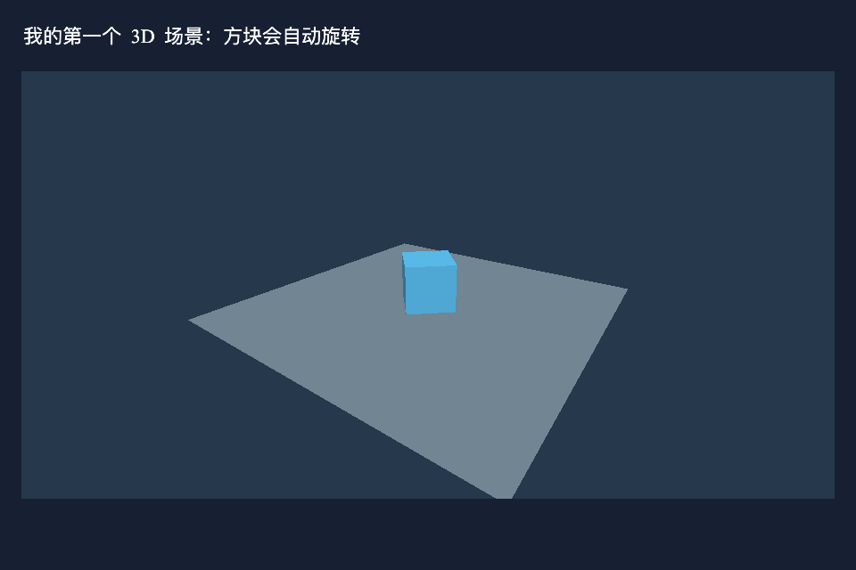
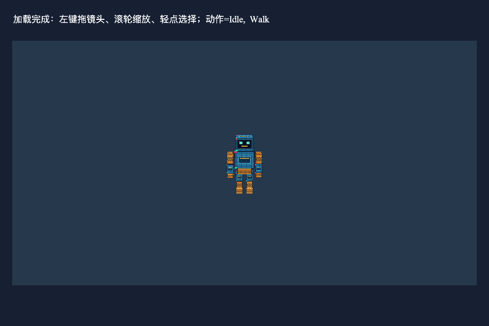

# hxmaker 3D 引擎新手指南

本文面向第一次使用 hxmaker 3D 的开发者。先创建一个能运行的方块场景，再学习加载角色、播放动画、操作相机、处理碰撞与寻路，以及添加光源、阴影和特效，最后了解性能和资源释放。

文档对应当前源码：三维显示类型使用 **`hx.display3d`**，三维视口仍是 **`hx.display.Scene3D`**。旧的 `hx.display.Node3D / MeshObject / Camera3D / Model3D / Model3DOptions` 已移除，没有兼容转发。仓库原有示例由用户另行整理，部分仍引用旧包；本文完整入门代码使用新包。

本文业务代码只使用 hxmaker API。OpenFL 是当前渲染后端，通过项目依赖接入。

## 阅读顺序

1. [了解目前能做什么](#support)
2. [理解视口、节点和模型](#concepts)
3. [准备项目](#setup)
4. [运行第一个 3D 场景](#first-scene)
5. [位置、旋转、缩放和父子关系](#transforms)
6. [几何、材质和贴图](#materials)
7. [通过 Assets 加载 GLB 角色](#assets)
8. [动画播放与过渡](#animation)
9. [骨骼挂点与道具](#sockets)
10. [光源与阴影](#lighting)
11. [粒子、拖尾与材质特效](#effects)
12. [相机与点击交互](#interaction)
13. [碰撞、重力、楼梯和坡道](#collision)
14. [导航图与路径跟随](#navigation)
15. [每帧更新与项目流程](#updates)
16. [资源释放](#lifecycle)
17. [多纹理合批、剔除和性能](#performance)
18. [进阶功能与边界](#advanced)
19. [常见问题](#faq)
20. [API 与专题文档索引](#reference)
21. [文档代码验证记录](#verification)

<a id="support"></a>
## 1. 目前支持什么

当前框架已经把模型显示、资源加载、动画、交互和基础角色运动连接起来，可以用于小型 3D 项目原型。项目是否能达到目标帧率，还取决于设备、分辨率、模型和玩法负载。

| 功能 | 当前支持 | 使用时要知道 |
| --- | --- | --- |
| 2D 与 3D 混用 | 3D 作为二维界面里的一个视口，可叠加文字、按钮与普通 UI | 每个视口独立绘制，再按二维顺序合成 |
| 三维对象树 | 父子节点、平移、旋转、缩放、显隐、精确局部矩阵 | 三维节点不直接加入二维 Stage 或 Sprite |
| 相机 | 透视相机、观察目标、环绕、跟随、平滑、缩放 | 暂无正交相机、相机碰撞和双指缩放手势 |
| 网格与材质 | 自建网格、方块、平面、坡道、贴图、颜色、透明与面剔除 | 可选 PBR 因子材质与静态 IBL，尚不支持完整 PBR 数据贴图 |
| GLB 资源 | Assets 加载 GLB 2.0 子集，内嵌基础色 PNG/JPEG 贴图 | 不等于支持任意 glTF 文件和扩展 |
| 骨骼动画 | 实例独立播放、暂停、定位、速度、循环、平滑过渡、事件 | 当前通用蒙皮主要由 CPU 处理 |
| 骨骼挂点 | 按导入节点索引创建挂点，附件跟随动作 | 暂无 IK、根运动、分层和加法动画混合 |
| 光照 | 环境光、方向光、点光、聚光，最多 4 灯共同参与 Lambert 漫反射 | PBR 直接光照与静态 IBL 尚待验收；无动态环境捕获和局部反射探针 |
| 阴影 | 主方向光硬阴影、PCF4、MASK 轮廓投影、自动或手动更新 | 无点光／聚光阴影、级联阴影和半透明投影；PCF4 是有限采样柔化 |
| 特效 | CPU 粒子、广告牌、序列帧、拖尾、刀光、流光与溶解、组合播放 | 特效材质默认无光照；不自动照亮周围物体 |
| 深度与后处理 | 软粒子交界淡出、视口 Bloom 泛光 | 这两项尚待验收；普通颜色目标，无 HDR 和选择性泛光 |
| 交互 | 左键/单指拖镜头、滚轮缩放、轻点选择、世界射线查询 | 三维节点没有自动接入二维鼠标冒泡链 |
| 碰撞查询 | 箱体、实心坡道代理，射线、球体和竖直胶囊重叠/扫掠 | 不是通用刚体物理或任意网格地形碰撞 |
| 角色运动 | 阻挡、滑动、重力、起跳、贴地、跨台阶、坡度限制 | 胶囊沿世界 Y 轴竖直，不模拟摆动手臂碰撞 |
| 寻路 | 显式路点图、A*、路径跟随、图变化重规划、受阻反馈 | 暂无自动 NavMesh 和多角色局部避障 |
| 渲染性能 | 多纹理合批、逐网格视锥剔除、静态视口复用、分段统计 | 暂无空间分块索引、遮挡剔除、自动 LOD 或 GPU 实例化 |
| 生命周期 | 对象释放、Assets 共享贴图、上下文资源重建相关处理 | 离开场景仍须主动释放自己拥有的对象和资源 |

当前主要验证环境是 HTML5 的 OpenGL/WebGL 路径。功能断言通过不代表所有平台、浏览器和设备均已验收。已有结果见[验收记录](3D导航验收记录.md)和[包迁移验证](3D显示API包迁移说明.md)。

<a id="concepts"></a>
## 2. 先认识六个概念

| 名称 | 可以怎样理解 | 常用类型 |
| --- | --- | --- |
| 视口 | 界面里用来显示 3D 画面的矩形区域 | `hx.display.Scene3D` |
| 节点 | 保存位置和父子关系，可以只作为分组容器 | `hx.display3d.Node3D` |
| 网格 | 一个可绘制对象，引用形状数据和材质 | `hx.display3d.MeshObject` |
| 几何 | 顶点在哪里、哪些顶点组成三角形 | `hx.geometry.Geometry3D` |
| 材质 | 如何使用颜色、贴图、透明和光照绘制表面 | `hx.material.Material3D` |
| 模型实例 | 从 GLB 创建的一套节点、网格与独立动画状态 | `hx.display3d.Model3D` |

一个 GLB 模型可以包含多个网格；一个模型不等于一个绘制调用。DrawCall 是向 GPU 提交一次绘制的调用，合批可以把兼容网格整理到较少的调用中。

二维和三维有各自的对象树：

```text
Game（hx.display.Stage）
└── DemoScene（hx.display.Scene）
    ├── Label / Button 等二维 UI
    └── Scene3D（二维视口）
        └── root（Node3D，三维树入口）
            ├── Camera3D
            ├── DirectionalLight3D
            ├── MeshObject
            └── Model3D
                └── 导入骨架、网格及运行时挂点
```

二维场景 `Scene` 负责组织页面与生命周期；`Scene3D` 负责提供三维画面。二者名称相近，但职责不同。

<a id="setup"></a>
## 3. 准备项目

### 3.1 依赖与工具链

先准备能正常编译 OpenFL HTML5 项目的 Haxe、Haxelib 与 Lime 环境。当前 hxmaker 3D 还依赖配套的 hxmaker-openfl 源码，两者需要同时更新。

本地开发通常把两个库指向仓库目录。下面路径是占位符，请替换为自己的绝对路径：

```bash
haxelib dev hxmaker /你的路径/hxmaker
haxelib dev hxmaker-openfl /你的路径/hxmaker-openfl
```

如果已有能运行的 hxmaker 项目，可以直接使用原有工程配置，跳到第 4 节。本文不要求业务代码直接操作 OpenFL 或浏览器。

### 3.2 创建最小目录

新建一个项目文件夹，内容如下。`Assets` 暂时可以为空：

```text
My3DGame/
├── project.xml
├── Assets/
└── Source/
    ├── Main.hx
    ├── Game.hx
    └── DemoScene.hx
```

将下面代码分别保存到对应文件。第 4 节提供其余三个完整文件。

**文件：`project.xml`**

```xml
<project>
    <meta title="我的第一个 hxmaker 3D 场景" package="demo.hxmaker.first3d" version="1.0.0" />
    <app main="Main" file="First3D" path="Export" />
    <source path="Source" />
    <assets path="Assets" rename="assets" />
    <haxelib name="hxmaker" />
    <haxelib name="hxmaker-openfl" />
    <haxelib name="openfl" />
    <haxelib name="openfl-glsl" />
    <haxelib name="vector-math" />
    <haxelib name="actuate" />
    <haxelib name="spine-haxe" />
    <window width="960" height="640" background="#172033" hardware="true" allow-high-dpi="true" />
</project>
```

`Source` 是 Haxe 源码目录，`Assets` 会以 `assets` 为运行时资源根路径。`Export` 保存构建结果。

本文配置沿用当前项目已有的依赖组合。不要在只有 Canvas 软件绘图能力的后端期待完整 Scene3D 绘制。

<a id="first-scene"></a>
## 4. 运行第一个 3D 场景

### 4.1 应用入口

**文件：`Source/Main.hx`**

```haxe
package;

import hx.core.HxmakerApplication;

/** 应用入口，只负责创建 hxmaker 舞台。 */
class Main extends HxmakerApplication {
    public function new() {
        super();
        init(Game, 960, 640);
    }
}
```

### 4.2 舞台入口

**文件：`Source/Game.hx`**

```haxe
package;

import hx.display.Stage;

/** 舞台负责把业务场景加入二维显示树。 */
class Game extends Stage {
    override public function onStageInit():Void {
        super.onStageInit();
        addChild(new DemoScene());
    }
}
```

### 4.3 完整方块场景

**文件：`Source/DemoScene.hx`**

```haxe
package;

import hx.display.Label;
import hx.display.Scene;
import hx.display.Scene3D;
import hx.display3d.Camera3D;
import hx.display3d.MeshObject;
import hx.geom.Vector3D;
import hx.geometry.BoxGeometry;
import hx.geometry.Geometry3D;
import hx.geometry.PlaneGeometry;
import hx.light.DirectionalLight3D;
import hx.material.LambertTextureMaterial;
import hx.material.Material3D;

/** 创建一个旋转方块、地面、相机和方向光。 */
class DemoScene extends Scene {
    private var view:Scene3D;
    private var cube:MeshObject;
    private var geometries:Array<Geometry3D> = [];
    private var materials:Array<Material3D> = [];

    override public function onStageInit():Void {
        super.onStageInit();
        updateEnabled = true;
        sceneBackground.data = 0x172033;
        sceneBackground.alpha = 1;

        var title = new Label("我的第一个 3D 场景：方块会自动旋转");
        title.x = 24;
        title.y = 24;
        title.color = 0xffffff;
        title.fontSize = 22;
        addChild(title);

        view = new Scene3D(912, 480);
        view.x = 24;
        view.y = 80;
        view.backgroundColor = 0x26384c;
        view.backgroundAlpha = 1;
        view.ambientIntensity = 0.35;
        addChild(view);

        var camera = new Camera3D();
        view.root.addChild(camera);
        view.camera = camera;
        camera.lookFrom(new Vector3D(5, 4, 7), new Vector3D(0, 0.5, 0));

        var light = new DirectionalLight3D(0xffffff, 0.8);
        light.direction = new Vector3D(-1, -2, -1);
        view.root.addChild(light);
        view.light = light;

        var cubeGeometry = BoxGeometry.create(1.2, 1.2, 1.2);
        var cubeMaterial = new LambertTextureMaterial(null, 0x58b8e8);
        geometries.push(cubeGeometry);
        materials.push(cubeMaterial);
        cube = new MeshObject(cubeGeometry, cubeMaterial);
        cube.y = 0.6;
        view.root.addChild(cube);

        var groundGeometry = PlaneGeometry.create(8, 8);
        var groundMaterial = new LambertTextureMaterial(null, 0x718592);
        geometries.push(groundGeometry);
        materials.push(groundMaterial);
        var ground = new MeshObject(groundGeometry, groundMaterial);
        view.root.addChild(ground);
    }

    override public function onUpdate(dt:Float):Void {
        super.onUpdate(dt);
        if (cube != null && !cube.isDisposed) {
            cube.rotationY += 35 * dt;
        }
    }

    override public function dispose():Void {
        if (isDisposed) return;
        // 先销毁节点树，让网格解除资源引用。
        super.dispose();
        for (geometry in geometries) geometry.dispose();
        for (material in materials) material.dispose();
        geometries = [];
        materials = [];
    }
}
```

进入项目根目录运行：

```bash
lime test html5
```

如果你的本机 Haxe/Lime 工具链需要使用此前项目采用的 x86_64 环境，在支持该运行方式的 macOS 上改用：

```bash
arch -x86_64 lime test html5
```

应看到二维标题、灰色地面和旋转的蓝色方块。初始例子没有加载外部图片，不需要提前寻找模型资源。



这个例子刻意显式保存自建几何与材质，在场景退出时释放。后面加载的 `Model3D` 有不同的资源所有权，见第 16 节。

<a id="transforms"></a>
## 5. 位置、旋转、缩放和父子关系

### 5.1 坐标与单位

三维采用右手坐标：X 向右、Y 向上，相机默认朝局部 -Z。二维 UI 的 Y 通常向下，不能直接把 UI 坐标当作三维坐标。

三维位置是世界单位，不是屏幕像素。项目可以约定 1 单位等于 1 米，但应让模型尺寸、角色胶囊、相机距离和重力采用同一套比例。

```haxe
// 本节假设 mesh 是已经加入 view.root 的 MeshObject。
mesh.setPosition(2, 1, 0);
mesh.rotationY = 45;       // 角度使用度，不是弧度。
mesh.setScale(0.5, 0.5, 0.5);
```

`x/y/z` 是相对于父节点的位置；`getWorldPosition()` 才是包含父节点变换后的世界位置。BoxGeometry 以中心为原点，1.2 高的箱子要把中心放到 Y=0.6，底部才刚好接触 Y=0 地面。

### 5.2 分组与挂接

```haxe
var group = new hx.display3d.Node3D();
view.root.addChild(group);
group.addChild(mesh);
group.rotationY = 30;
```

父节点的移动、旋转和缩放会影响子节点。`addChild` 自动把节点从原父节点移除；重新挂接时保留局部变换，不保证保持原世界位置。`remove()` 只移出父节点，`dispose()` 才销毁节点及子树。

`visible=false` 隐藏整个子树。负缩放可用于镜像；零缩放会使网格退化，渲染与拾取跳过它。角色控制器要求相关父变换可逆，不能把受控角色放在零缩放父节点下。

`getLocalMatrix()` 和 `getWorldMatrix()` 返回副本。需要应用精确仿射矩阵时调用 `setLocalMatrix()`；以后修改旋转或缩放会回到标量 TRS 变换，不保留原矩阵的错切分量。初学者优先使用位置、旋转和缩放属性。

<a id="materials"></a>
## 6. 几何、材质和贴图

### 6.1 创建形状

| API | 形状与原点 |
| --- | --- |
| `BoxGeometry.create(width, height, depth)` | 原点位于箱体中心 |
| `PlaneGeometry.create(width, depth)` | 位于 XZ 平面，正面朝 +Y |
| `RampGeometry.create(width, height, depth)` | 底面 Y=0，沿局部 +Z 从零上升到 height |
| `new Geometry3D(positions, uvs, indices, normals)` | 自己提供三角形网格，normals 可省略 |

自建网格的 `positions` 每顶点存 3 个数，`uvs` 每顶点存 2 个数，`indices` 每 3 个索引组成三角形。直接修改这些数组后调用 `geometry.invalidate()`，让包围盒与渲染缓存更新。

光照使用法线判断表面朝向。缺少法线时，`getNormals()` 按三角形生成平滑法线；硬边需要拆分顶点或提供显式法线。用 `setNormals(values)` 提供法线后，修改顶点位置时应自己同步维护法线。

### 6.2 选择材质

| 材质 | 适用效果 |
| --- | --- |
| `UnlitTextureMaterial(texture, color)` | 不受光照影响的基础色或贴图 |
| `LambertTextureMaterial(texture, color)` | 受环境光、方向光、点光和聚光影响的漫反射表面 |
| `EffectMaterial3D(texture, blend, color)` | 无光照透明／加法特效，保留深度遮挡 |
| `AnimatedEffectMaterial3D(texture, blend, color)` | 增加 UV 流动、遮罩、噪声扰动和溶解 |

`texture=null` 表示使用白图，此时直接显示基础颜色。颜色采用 `0xRRGGBB`，透明度单独设置。

```haxe
var material = new hx.material.UnlitTextureMaterial(null, 0xff8844);
material.opacity = 0.5;
material.alphaMode = hx.material.AlphaMode3D.BLEND;
material.cullMode = hx.material.CullMode3D.NONE;
```

| Alpha 模式 | 用途 |
| --- | --- |
| `OPAQUE` | 不透明表面，不按贴图 Alpha 显示透明 |
| `MASK` | Alpha 低于 `alphaCutoff` 的部分丢弃，适合硬边镂空 |
| `BLEND` | 半透明混合，保留深度测试，绘制时关闭深度写入 |

只把 `opacity` 改小但继续用 `OPAQUE`，不会得到预期的半透明效果。透明网格按包围盒中心从远到近排序，交叉透明面仍可能有排序问题。

`CullMode3D.BACK` 默认剔除背面，`FRONT` 剔除正面，`NONE` 双面绘制。平面从背后看不见时先检查朝向与剔除设置。

### 6.3 通过 Assets 加载普通贴图

下面是局部示意，放在已经创建 `view` 的场景方法中。**把 request 和创建的几何、材质保存为场景字段，按第 16 节顺序释放；不要把这段当成自动管理生命周期的完整场景。**

```haxe
var request = new hx.assets.Assets();
request.loadBitmapData("assets/crate.png");
request.onError(error -> {
    request.stop();
    request.clean();
    trace("贴图加载失败：" + error.error);
});
request.onComplete(_ -> {
    if (isDisposed) {
        request.clean();
        return;
    }
    var geometry = hx.geometry.BoxGeometry.create();
    var material = new hx.material.UnlitTextureMaterial(request.getBitmapData("crate"));
    var mesh = new hx.display3d.MeshObject(geometry, material);
    view.root.addChild(mesh);
    // 在这里把 geometry、material 和 request 登记到场景的资源管理字段。
});
request.start();
```

优先使用整图 PNG/JPEG。也支持未旋转、没有裁边还原信息的矩形图集区域；不支持旋转图集与分离 Alpha 压缩纹理。

`smoothing=true` 使用线性放大过滤；像素风可改成 false。`textureMinSmoothing` 可以单独决定缩小过滤，null 时沿用 smoothing。当前没有生成 mipmap。

```haxe
material.textureWrapU = hx.material.TextureWrap3D.REPEAT;
material.textureWrapV = hx.material.TextureWrap3D.REPEAT;
```

重复与镜像采样当前要求无填充的二次幂整图，例如 256×256 或 512×256；不能直接用于图集子区域。非二次幂图片使用默认 `CLAMP`。改变 UV 来重复图片前，先确认包裹模式和图片条件都满足。

<a id="assets"></a>
## 7. 通过 Assets 加载 GLB 角色

### 7.1 源资产与模型实例

GLB 是把模型数据及相关资源放在一个二进制文件里的格式。当前支持的是 GLB 2.0 的明确子集，具体格式限制见第 18 节。

加载链路为：

```text
Assets.loadModel
→ 下载二进制
→ 解析模型和动画
→ 通过资产系统解码内嵌图片
→ Assets 完成
→ getModel 取得共享源资产
→ createInstance 创建独立模型实例
```

`Assets.onComplete` 到达时，GLB 的内嵌贴图也已经准备好。`ModelAsset.fromBytes` 只是同步解析入口，不能代替含图片 GLB 的完整加载流程。

同一份源资产可以创建多个 `Model3D`。实例拥有各自的姿态、播放状态和运行时几何材质，源图片由加载它的 Assets 共享持有。

实例化选项类型为 `hx.display3d.Model3DOptions`，目前提供 `lightingEnabled`，默认 false。想使用基础光照时显式传入 true。

### 7.2 没有自己的资源时怎么办

可以从 hxmaker 仓库的 `samples/3d/textured-character/Assets/robot.glb` 复制机器人文件到新项目 `Assets/robot.glb`。它包含基础色贴图、骨骼和 Idle/Walk 动作，不需要下载外部素材。后续换自己的文件时，也应检查动作名称、尺寸和导出特性。

### 7.3 完整的模型加载场景

保留第 3～4 节的 project.xml、Main.hx 和 Game.hx，**用下面内容完整替换 `Source/DemoScene.hx`**。这是一套独立于方块版本的完整场景；不要把两个同名类同时保留。

这个版本支持加载提示、错误提示、动画、左键环绕、滚轮缩放、点击选择和退出清理。

**文件：`Source/DemoScene.hx`（GLB 版本，替换前一版本）**

```haxe
package;

import hx.assets.Assets;
import hx.controls3d.OrbitCameraController3D;
import hx.controls3d.Scene3DInput;
import hx.display.Label;
import hx.display.Scene;
import hx.display.Scene3D;
import hx.display3d.Camera3D;
import hx.display3d.Model3D;
import hx.events.Scene3DInputEvent;
import hx.geom.Vector3D;
import hx.light.DirectionalLight3D;

/** 通过 Assets 加载带贴图和动画的角色，不直接访问后端。 */
class DemoScene extends Scene {
    private var view:Scene3D;
    private var model:Model3D;
    private var assets:Assets;
    private var orbit:OrbitCameraController3D;
    private var input:Scene3DInput;
    private var status:Label;

    override public function onStageInit():Void {
        super.onStageInit();
        updateEnabled = true;
        sceneBackground.data = 0x172033;
        sceneBackground.alpha = 1;

        status = new Label("正在加载机器人……");
        status.x = 24;
        status.y = 24;
        status.color = 0xffffff;
        status.fontSize = 18;
        addChild(status);

        view = new Scene3D(912, 480);
        view.x = 24;
        view.y = 80;
        view.backgroundColor = 0x26384c;
        view.backgroundAlpha = 1;
        view.ambientIntensity = 0.4;
        addChild(view);

        var camera = new Camera3D();
        view.root.addChild(camera);
        view.camera = camera;
        orbit = new OrbitCameraController3D(camera, new Vector3D(0, 1, 0));
        orbit.distance = 7;
        orbit.pitch = 20;
        orbit.minPitch = 5;
        orbit.snap();

        var light = new DirectionalLight3D(0xffffff, 0.8);
        light.direction = new Vector3D(-1, -2, -1);
        view.root.addChild(light);
        view.light = light;

        input = new Scene3DInput(view, orbit);
        input.addEventListener(Scene3DInputEvent.SELECT, onSelect);
        loadRobot();
    }

    private function loadRobot():Void {
        var request = new Assets();
        assets = request;
        request.tryLoadTimes = 0;
        request.loadModel("assets/robot.glb");
        request.onError(error -> {
            request.stop();
            request.clean();
            if (!isDisposed) status.data = "加载失败：" + error.error;
        });
        request.onComplete(_ -> {
            // 退出场景后，原生请求仍可能完成；不要创建已经失去用途的实例。
            if (isDisposed) {
                request.clean();
                return;
            }
            try {
                var source = request.getModel("robot");
                if (source == null) throw "没有取得 robot 资源";
                model = source.createInstance(-1, {lightingEnabled: true});
                model.setScale(0.6, 0.6, 0.6);
                view.root.addChild(model);
                var names = model.animation.names;
                if (names.length > 0) {
                    var first = names.indexOf("Idle") >= 0 ? "Idle" : names[0];
                    model.animation.play(first, true);
                }
                status.data = "加载完成：左键拖镜头、滚轮缩放、轻点选择；动作=" + names.join(", ");
            } catch (error:Dynamic) {
                if (model != null) {
                    model.dispose();
                    model = null;
                }
                request.stop();
                request.clean();
                status.data = "创建模型失败：" + Std.string(error);
            }
        });
        request.start();
    }

    private function onSelect(event:Scene3DInputEvent):Void {
        status.data = event.hit == null ? "点击了空白区域" : "选中网格：" + event.hit.object.name;
    }

    override public function onUpdate(dt:Float):Void {
        super.onUpdate(dt);
        if (model != null) model.update(dt);
        if (orbit != null) orbit.update(dt);
    }

    override public function dispose():Void {
        if (isDisposed) return;
        if (input != null) input.dispose();
        if (orbit != null) orbit.dispose();
        // 模型不再使用源图片后，才允许清理 Assets。
        if (model != null) model.dispose();
        super.dispose();
        if (assets != null) {
            assets.stop();
            assets.clean();
        }
    }
}
```



`getModel("robot")` 使用此文件在 Assets 中的名称。文件换名后，要一起更新加载地址与取得资源的名称。

上面的 0.6 缩放和观察中心为仓库机器人设置。自己的模型太大或太小时应调整模型比例和相机；模型的源原点也可能不在脚底。`model.getBounds()` 返回模型局部包围盒，可辅助检查尺寸和取景。

### 7.4 创建多个角色

在 Assets 完成回调中，可以多次从同一个 source 实例化：

```haxe
var second = source.createInstance(-1, {lightingEnabled: true});
second.setScale(0.6, 0.6, 0.6);
second.x = 2;
view.root.addChild(second);
```

这里的 `source` 来自该回调内的 `request.getModel("robot")`。新增角色也要保存、逐帧更新一次，并在 Assets 清理前销毁。一个实例改变动作、姿态或材质，不会把另一个实例的播放状态一起修改。

<a id="animation"></a>
## 8. 动画播放与过渡

以下片段假设 `model` 已加载成功。先检查 `model.animation.names`，不要认为所有模型都包含 Idle、Walk 或 Attack。

```haxe
trace(model.animation.names);
model.animation.play("Idle", true);
```

| API | 用法 |
| --- | --- |
| `play(name, loop=true)` | 从头播放，重复调用会反复重置动作 |
| `crossFade(name, seconds=0.2, loop=true)` | 从当前姿态平滑过渡到新动作 |
| `pause() / resume()` | 暂停或继续，保留当前姿态 |
| `seek(seconds)` | 定位到片段内时间，取消正在进行的过渡 |
| `speed` | 播放倍率，默认 1；0 冻结，不能为负 |
| `stop()` | 停止并恢复模型初始姿态 |
| `currentName / time / duration` | 当前目标动作名、播放秒数和时长 |
| `transitioning / transitionProgress` | 是否过渡以及 0～1 的进度 |

**只在动作需要改变时发出播放指令，每帧只推进 `model.update(dt)`。** 例如已经计算出实际水平移动量后：

```haxe
var clip = moved ? "Walk" : "Idle";
if (model.animation.currentName != clip) {
    model.animation.crossFade(clip, 0.2, true);
}
model.update(dt);
```

`moved` 是业务根据真实位移计算的布尔值。不要只根据“有移动目标”切换 Walk，否则撞墙停住时也会原地走路。`crossFade` 的正时长版本遇到同名目标不会重播；需要从头播放同一动作时用 `play`。

过渡支持平移和缩放插值、四元数旋转最短路径混合。连续中断过渡时，从当前输出姿态快照继续，不跳回初始姿态。片段缺少的轨道回到模型初始姿态，而不是继承上一段残留值。

### 8.1 监听播放事件

```haxe
model.animation.addEventListener(hx.events.AnimationEvent3D.COMPLETE,
    function(event:hx.events.AnimationEvent3D) {
        trace("动作完成：" + event.clipName);
    });
```

支持 `START`、`LOOP`、`COMPLETE` 和 `FADE_COMPLETE`。事件包含片段名、相对时间；循环事件还包含本次跨越次数 `loopCount`。循环播放使用 LOOP，非循环播放才会正常到达单次完成事件。

事件在最终姿态应用后派发。大 dt 跨多次循环会合并通知；监听中再次调用播放命令会按播放器的延迟命令规则处理。复杂事件重入和零时长片段细节见[动画专题](3D动画过渡与骨骼挂点使用说明.md)。

<a id="sockets"></a>
## 9. 骨骼挂点与道具

挂点是放在某个骨骼下的普通 `Node3D`。它继承骨骼动画，道具可以通过挂点保留自己的局部偏移。

在 GLB 完成加载后查询手腕节点。下面用仓库机器人的 `Wrist.R` 为例，其他模型需要使用自己的节点名：

```haxe
var hands = model.findNodes("Wrist.R");
if (hands.length == 1) {
    var index = model.getNodeIndex(hands[0]);
    var socket = model.createSocket(index, "weapon");
    socket.setPosition(0, -0.12, 0.08);
    // prop 是你已经创建的 Node3D 或 MeshObject。
    socket.addChild(prop);
}
```

| API | 返回结果 |
| --- | --- |
| `getNodeByIndex(index)` | 对应的活动导入节点，无效时为 null |
| `findNodes(name)` | 全部同名活动导入节点，允许重名 |
| `getNodeIndex(node)` | 导入节点索引；外部节点、挂点或非活动节点为 -1 |
| `createSocket(nodeIndex, name)` | 模型拥有的普通挂点节点 |

节点名不保证唯一，不应直接假定 `findNodes(name)[0]` 总是正确。返回的导入节点是借用引用；不要把骨架拆开、重新挂接或单独销毁，也不要把直接修改骨骼 TRS 当作已经支持的 IK 或叠加动画接口。

角色整体位置改在 `Model3D` 外层，附件偏移改在 socket 或道具自身。模型销毁会销毁挂点和仍挂在其下的附件；想保留道具时先把它移出。外部自建的道具几何和材质仍由创建者释放。

<a id="lighting"></a>
## 10. 光源与阴影

无光照材质直接显示基础颜色和贴图。需要表面明暗时选择 `LambertTextureMaterial`，或创建 GLB 实例时传 `{lightingEnabled: true}`。下面片段假设 `view`、相机和待照明网格已创建；可接到第 4 节的方块场景中。

### 10.1 先选择灯光类型

| 类型 | 作用 | 常用场景 |
| --- | --- | --- |
| 环境光 | 给所有受光表面提供统一底色，不随位置衰减 | 避免背光面全黑 |
| `DirectionalLight3D` | 平行方向照明，位置不改变照明结果 | 太阳、全场主光 |
| `PointLight3D` | 从节点世界位置向四周照明，在 range 内衰减 | 火把、灯泡、爆炸补光 |
| `SpotLight3D` | 在点光距离衰减上限制方向与内外光锥 | 手电筒、舞台灯 |

光源影响的是表面亮度，不会自动画出灯泡、光束或空气中的光柱。需要看到灯体可另外创建无光照网格；光柱可用透明网格或粒子表现。

### 10.2 环境光和主方向光

```haxe
view.ambientColor = 0xffffff;
view.ambientIntensity = 0.2;
var light = new hx.light.DirectionalLight3D(0xffffff, 0.8);
light.direction = new hx.geom.Vector3D(-1, -2, -1);
view.root.addChild(light);
view.light = light;
```

灯光必须先加入该视口的三维树。`view.light` 保留为主方向光入口；其他方向光也可通过 `view.addLight(otherLight)` 注册。

`direction` 表示光传播方向，`(-1,-2,-1)` 表示向下传播，不是灯的位置。节点旋转会影响世界方向。读取 direction 得到副本，修改后需要重新赋值。环境光会保留在阴影区；没有法线或法线方向错误时，仅增大灯光强度不能修复表面朝向。

### 10.3 点光、聚光与多光源

```haxe
var point = new hx.light.PointLight3D(0xff7040, 2, 8);
point.setPosition(-2, 2, 1);
view.root.addChild(point);
view.addLight(point);

var spot = new hx.light.SpotLight3D(0x80b8ff, 3, 12);
spot.setPosition(2, 6, 0);
spot.direction = new hx.geom.Vector3D(0, -1, 0);
spot.innerAngle = 18;
spot.outerAngle = 30;
view.root.addChild(spot);
view.addLight(spot);
```

点光与聚光构造参数依次为颜色、强度和照明范围。`range` 为正有限的世界距离，不随父节点缩放改变。距离衰减使用 `max(1-distance/range, 0)²`；这里的 intensity 是效果调节参数，不是流明或坎德拉。

聚光角度是**半角**，单位为度，必须满足 `0 ≤ innerAngle < outerAngle < 90`。内锥中保持完整角度贡献，内外锥之间平滑衰减，外锥以外不照明。父节点的移动、旋转和显隐会影响灯光。

| 操作或规则 | 行为 |
| --- | --- |
| `view.addLight(light)` | 显式注册；重复注册不改变顺序 |
| `view.removeLight(light)` | 取消注册，不移除或销毁节点 |
| `view.light = null` | 清除主方向光入口；仍可保留其他注册灯光 |
| `light.visible = false` / `intensity = 0` | 暂停贡献，不占本次照明名额 |
| 最多 4 灯 | 主方向光优先，其余按注册顺序；不是按距离自动选灯 |
| 隐藏、销毁或移出场景 | 对应灯光不参与计算 |
| `view.lights` | 返回显式注册列表的副本 |
| `view.getActiveLights()` | 返回全部有效灯光，后端再按上限截取 |

主方向光也在注册列表中时不会重复计算。只调用 `removeLight` 不会清除 `view.light`；两个入口都设置过时，需要分别清理。再次加入场景的已注册节点会重新具备参与条件，不再使用时应主动取消注册。

新多光源路径在 Shader 编译失败时，先减少多纹理槽位，再逐步减少灯光上限。通过 `view.stats.activeLights` 与 `skippedLights` 观察实际参与和跳过数量；统计对应最近的绘制结果。新增实现尚未编译或运行验收，需要同步更新核心与 `hxmaker-openfl` 后端。

完整交互场景见[多光源示例](../samples/3d/multi-light-3d/README.md)，包含灯光开关、衰减范围、锥角、第五灯超限展示，以及拖动环绕、滚轮缩放和镜头复位。

### 10.4 开启阴影：灯、投射物、接收面

只有 `view.light` 指定的主方向光提供阴影。沿用上面保存的 `light`，再对已有方块 `cube` 和地面 `ground` 设置：

```haxe
light.shadowEnabled = true;
light.shadowMapSize = 1024;
cube.castShadow = true;
ground.receiveShadow = true;
```

若使用 GLB 模型，则遍历 `model.meshes` 设置 `castShadow=true`。接收面必须使用光照材质。第 7 节的 GLB 完整场景没有地面，打开阴影不会自动创建地面；可按第 4 节增加 Lambert 平面。

| 设置 | 默认值 | 说明 |
| --- | --- | --- |
| `light.shadowEnabled` | false | 请求开启主光阴影 |
| `light.shadowMapSize` | 1024 | 二次幂边长，范围 16～8192，实际受设备限制 |
| `light.shadowBias` | 0.001 | 固定深度偏差 |
| `light.shadowSlopeBias` | 0.002 | 随表面角度变化的偏差 |
| `light.shadowPadding` | 0.1 | 自动阴影范围留边比例 |
| `light.shadowBounds` | null | 可选固定世界空间范围 |
| `light.shadowFilter` | `ShadowFilter3D.HARD` | 硬阴影或 `PCF4` 四次比较柔化 |
| `light.shadowAutoUpdate` | true | 检测投射内容等变化后更新阴影 |
| `mesh.castShadow` | false | 是否参与投射 |
| `mesh.receiveShadow` | true | 是否接收主方向光阴影 |

阴影只衰减主方向光贡献，环境光和其他灯光仍保留，因此补光较强时阴影可能不明显。

### 10.5 柔化、镂空投影与缓存

```haxe
light.shadowFilter = hx.light.ShadowFilter3D.PCF4;

// 固定投影内容时可手动控制更新；首次启用和目标重建仍会生成阴影。
light.shadowAutoUpdate = false;
// 移动物体或修改投影内容后，按业务需要请求更新。
light.requestShadowUpdate();
```

PCF4 只进行四次深度比较，可以减轻硬边，不等于具有光源面积的真实软阴影。自动更新模式也会复用没有变化的阴影，状态可查看 `shadowCacheHit`。

普通 `OPAQUE` 和 `MASK` 网格可以投影；MASK 按基础贴图 Alpha、材质 opacity 和 `alphaCutoff` 裁剪轮廓，适合叶片、栅栏等硬边镂空。具有自定义 `fragmentCode` 或 `fragmentUVCode` 的网格不走简化投射路径；`BLEND` 不投射半透明阴影。几何拾取仍不读取贴图 Alpha。

出现条纹时可适当增大 bias；阴影像悬空时检查 bias 是否过大。范围太大而贴图太小时边缘会粗糙，优先缩小合理覆盖范围，再考虑提高分辨率。

最终是否生效看 `view.stats.shadowStatus`。缺少深度纹理、纹理槽不足或目标创建失败时，会降级为只有照明。当前没有点光阴影、聚光阴影或级联阴影。更多细节见[光照与阴影专题](基础3D光照与阴影使用说明.md)；其中早期能力限制以当前源码和本章为准。

<a id="effects"></a>
## 11. 粒子、拖尾与材质特效

先根据需要选择组件，不必从自定义 Shader 开始：

| 想做的效果 | 组件 |
| --- | --- |
| 始终朝向镜头的光斑、标记 | `Billboard3D` |
| 火焰、烟雾、火花、爆炸 | `ParticleSystem3D` + `ParticleSettings3D` |
| 子弹、火球的运动轨迹 | `Trail3D` + `TrailSettings3D` |
| 武器两端扫过的刀光 | `Ribbon3D` |
| UV 流动、遮罩、扰动、溶解 | `AnimatedEffectMaterial3D` |
| 多个发射器和拖尾按时间配合 | `Effect3D` |
| 烟雾与地面交界淡出 | 材质 `softParticleDistance` |
| 亮部周围光晕 | 视口 `bloom` |

特效材质默认无光照，`BlendMode3D.NORMAL` 适合烟雾，`ADD` 适合火花与发光。**加法混合与 Bloom 不会照亮周围模型**；火球需要照亮墙面时，另外添加 PointLight3D。

### 11.1 先做一个无需贴图的粒子喷泉

以下是接入片段，不是完整类。把 `particles`、`particleMaterial` 保存为业务场景字段，在创建 view 与相机后初始化：

```haxe
var particleMaterial = new hx.material.EffectMaterial3D(
    null, hx.material.BlendMode3D.ADD, 0xffaa44);
var settings = new hx.effect3d.ParticleSettings3D();
settings.maxParticles = 256;
settings.emissionRate = 30;
settings.duration = 0;
settings.burst = 12;
settings.lifetimeMin = 0.6;
settings.lifetimeMax = 1.2;
settings.coneAngle = 25;
settings.gravity.setTo(0, -2, 0);
settings.size = new hx.effect3d.FloatCurve3D([0., 0.2, 1.], [0., 1., 0.]);
settings.alpha = new hx.effect3d.FloatCurve3D([0., 0.7, 1.], [1., 1., 0.]);
var particles = new hx.display3d.ParticleSystem3D(particleMaterial, settings);
view.root.addChild(particles);
particles.setPosition(0, 1, 0);
particles.play();
```

然后在场景 `onUpdate(dt)` 中、相机更新之后调用：

```haxe
particles.update(dt, view.camera);
```

没有贴图时粒子是方形亮片，便于先确认发射、运动和生命周期；再换成带透明边缘的粒子图片。曲线输入是零至一的归一化寿命，尺寸曲线还会乘出生随机尺寸。

`duration=0` 表示持续发射；正数表示发射到期后自然收尾。`play()` 会清空旧粒子并重播，不能每帧调用。`stop()` 停止发射但保留存活粒子，必须继续 update 才能消失；`stop(true)` 立即清空。`Event.COMPLETE` 可用于回收效果。

`worldSpace=true` 时出生粒子脱离发射器移动；false 时中心跟随父节点。广告牌尺寸使用世界单位，不随父节点缩放自动放大。`maxParticles` 允许 1～16383，建议先从较小容量开始。

### 11.2 广告牌和序列帧

```haxe
var billboard = new hx.display3d.Billboard3D(particleMaterial);
view.root.addChild(billboard);
billboard.billboardWidth = 2;
billboard.billboardHeight = 2;
billboard.lockY = true;
// 每帧在相机更新后调用。
billboard.update(view.camera);
```

普通广告牌朝向相机；lockY 保持世界竖直。使用等尺寸序列帧图集时，为粒子设置 `settings.sheet = new hx.effect3d.SpriteSheet3D(4, 4, 12)`，按寿命播放 4×4 图集的前 12 帧。独立广告牌可设置 `sheet` 和 `frame` 手动选帧，图片本身需由 Assets 加载并赋给材质。

### 11.3 弹道拖尾与刀光

下面假设 `projectile` 是已经加入 view.root 的运动节点：

```haxe
var trailSettings = new hx.effect3d.TrailSettings3D();
trailSettings.width = 0.2;
trailSettings.lifetime = 0.4;
trailSettings.maxSections = 128;
trailSettings.minDistance = 0.02;
trailSettings.breakDistance = 3;
var trail = new hx.display3d.Trail3D(particleMaterial, trailSettings);
view.root.addChild(trail);
trail.target = projectile;
trail.play();
// 每帧先移动 projectile、更新相机，再调用。
trail.update(dt, view.camera);
```

轨迹保存在世界空间，不会跟着目标整体平移。暂停时设置 `trail.paused=true`，仍调用 update，让带状网格继续响应镜头方向。`stop()` 停止采样并自然淡出，`stop(true)` 立即清除；`breakDistance` 用于避免瞬移拉出贯穿场景的长条。

刀光改用 `Ribbon3D`，把 `startNode`、`endNode` 绑定到刀根、刀尖节点或骨骼挂点。每帧先推进角色动画和武器位置，再调用 `ribbon.update(dt, view.camera)`；镜头变化不会改变刀光的真实世界形状。

### 11.4 流光、溶解与组合播放

下面的 baseTexture、maskTexture 是 Assets 已加载的位图；保存 material 为场景字段，并用于普通网格、广告牌或粒子：

```haxe
var material = new hx.material.AnimatedEffectMaterial3D(
    baseTexture, hx.material.BlendMode3D.ADD, 0x66bbff);
material.maskTexture = maskTexture;
material.uvSpeedU = 0.2;
material.distortion = 0.04;
material.dissolve = 0.3;
material.edgeColor = 0xffcc66;
material.edgeWidth = 0.08;
// 每帧推进材质时间，也提交直接修改的动态参数。
material.update(dt);
```

遮罩使用红通道乘透明度；噪声贴图为空时可使用程序化噪声。dissolve 从零到一对应从显示到消失。这里的扰动只改变材质纹理取样，不是折射或对场景背景的热浪扭曲。同一个动态材质每帧只更新一次，不能按使用它的网格数量重复推进。

多个效果可以交给组合播放器：

```haxe
// particles 和 trail 均为尚未播放的节点，且不再单独 update。
var effect = new hx.display3d.Effect3D();
view.root.addChild(effect);
effect.addEmitter(particles, 0);
effect.addRibbon(trail, 0.2, 0.6);
effect.play();
// 每帧只推进组合播放器；动态材质仍需另行 update。
effect.update(dt, view.camera);
```

本段是独立的组合方式，不能直接把上一段仍在播放的节点加入轨道；加入前需 `stop(true)`。播放器拥有轨道节点，支持 paused、speed、loop 和 COMPLETE 事件；共享材质与贴图仍由创建者管理。

### 11.5 软粒子与 Bloom 泛光

软粒子在透明效果与不透明场景相交时淡出，减轻烟雾穿过地面的硬交界：

```haxe
particleMaterial.softParticleDistance = 0.5;
// 设为零关闭，仅对 BLEND 材质生效。
```

它会增加一次独立场景深度预绘制。透明物体不会相互提供软粒子深度，也不能依靠它解决透明排序。能力或资源不足时回退普通透明绘制，查看 `view.stats.softParticleStatus`。

Bloom 提取整个视口的亮部，再模糊叠加光晕：

```haxe
view.bloom.enabled = true;
view.bloom.threshold = 0.65;
view.bloom.intensity = 0.8;
view.bloom.radius = 2;
view.bloom.renderScale = 0.5;
```

当前是普通 RGBA8 颜色目标上的 Bloom，没有 HDR。阈值范围为零至一，较亮的普通物体与背景也会参与；不是只让特效发光。开启时增加两个降采样颜色目标和三次全屏绘制，关闭后释放泛光目标。实际状态看 `view.stats.bloomStatus`。

软粒子、Bloom 以及新多光源路径均尚待本轮运行验收。粒子、拖尾与动态材质的前两个特效阶段已有用户反馈通过；不要把历史结果当成新增组合的验证。完整效果演示见[特效示例](../samples/3d/effects-3d/README.md)。

### 11.6 更新顺序和退出清理

每帧先更新角色与武器、相机，再推进动态材质、粒子、广告牌、拖尾或组合播放器。暂停特效模拟时仍可更新镜头及朝向；`Scene3D.autoRender` 只控制绘制，不代替这些业务 update。

粒子、广告牌和拖尾节点拥有自己的动态几何，dispose 时会释放；共享材质与 Assets 贴图不由它们接管。先销毁效果节点或 view，再 dispose 自建材质，最后清理 Assets。已经加入 Effect3D 的轨道由播放器随子树销毁，不再重复独立管理。

<a id="interaction"></a>
## 12. 相机与点击交互

### 12.1 固定观察与环绕相机

固定观察使用 `camera.lookFrom(worldPosition, worldTarget)`，或设置相机位置后调用 `lookAt(target)`。投影参数主要有：

| 属性 | 默认值 | 含义 |
| --- | --- | --- |
| `fieldOfView` | 60 | 垂直视场角，单位为度，范围 (0,180) |
| `near` | 0.1 | 正的近裁剪距离 |
| `far` | 1000 | 远裁剪距离，必须大于 near |

不要无限拉大 far，先让裁剪范围覆盖实际玩法区域。

第 7 节已接入环绕控制器。可以调整：

```haxe
orbit.yaw = 15;
orbit.pitch = 25;
orbit.distance = 8;
orbit.minDistance = 1;
orbit.maxDistance = 30;
orbit.damping = 12;
orbit.snap();
```

`yaw` 和 `pitch` 是度数，`distance` 是世界距离。yaw=0 时相机在观察点的 +Z 一侧。`snap()` 立即应用，`update(dt)` 平滑追赶；`rotate(deltaYaw, deltaPitch)` 和 `zoomBy(factor)` 可由业务按钮调用。缩放倍率大于 1 拉远，小于 1 拉近。

同一个相机同一帧由一个控制器驱动。不要同时每帧调用 `lookAt` 和另一个相机控制器，让两者争夺姿态。

### 12.2 跟随角色

角色加载后创建跟随控制器：

```haxe
var follow = new hx.controls3d.FollowCameraController3D(view.camera, model);
follow.targetOffset.setTo(0, 1.5, 0);
follow.distance = 8;
follow.pitch = 25;
follow.snap();
input.controller = follow;
```

保存 follow 为场景字段，并在原来的 `orbit.update(dt)` 位置改为 `follow.update(dt)`；原 orbit 不再驱动相机，不再使用时销毁。偏移采用世界坐标，不跟角色旋转。切换跟随目标可以设置 `follow.targetNode`。

### 12.3 鼠标与触摸

`Scene3DInput` 绑定具体视口和可选环绕/跟随控制器，使用已有 hxmaker 输入系统：

- 左键或单指移动超过默认 5 个舞台逻辑像素后拖动镜头。
- 滚轮缩放；当前没有双指缩放手势。
- 轻点在抬起确认后派发 SELECT，拖动结束不会误下达选择指令。
- SELECT 的舞台坐标、射线和命中来自按下时快照；镜头还在平滑运动时不需要等待其停止。
- 视口没有收到的 UI 点击不会启动该视口操作；自定义 UI 应按已有事件规则消费输入。
- `input.cancel("原因")` 或 `input.enabled=false` 可以解除当前捕获。

可监听 `SELECT`、`DRAG_BEGIN`、`DRAG_END`、`CANCEL`，并读取 `capturing`、`dragging`、`pointerId`。不要把三维网格的普通 MouseEvent 监听当作已经提供的逐对象交互系统，应从视口选择事件读取 `event.hit.object` 或 `event.hit.model`。

### 12.4 点击地面与世界射线

下面是 SELECT 回调的局部逻辑，展示如何和无限水平面 Y=0 求交。它只得到目标点，不自动移动角色，也不代表目标可达：

```haxe
if (event.ray != null) {
    var distance = event.ray.intersectPlane(new hx.geom.Vector3D(0, 1, 0), 0, 100);
    if (distance != null) {
        var target = event.ray.at(distance);
        trace("地面目标：" + target);
    }
}
```

有真实碰撞世界时，优先用 `world.raycast(event.ray, 100)` 取得地面或坡面接触点，并检查表面方向。无限平面求交不会自动检查场景边界或墙壁。

| 查询入口 | 输入与用途 |
| --- | --- |
| `view.stageToViewport(stageX, stageY)` | 舞台坐标转逻辑视口坐标，失败返回 null |
| `view.stageRay(stageX, stageY)` | 舞台坐标转世界射线，起点在近裁剪面 |
| `view.pick(stageX, stageY, maxDistance, filter)` | 查询可拾取网格，保留相机近远裁剪 |
| `view.raycast(ray, maxDistance, filter)` | 世界射线查询三维树，不继承相机近远裁剪 |
| `Raycaster3D.intersect(root, ray, maxDistance, filter)` | 查询指定三维子树 |
| `world.raycast(ray, maxDistance, mask, includeTriggers)` | 查询显式注册的碰撞代理，不查询模型三角形 |

`maxDistance=null` 表示没有额外距离限制，距离单位为世界单位。几何命中包含网格、所属模型、世界位置、世界距离、三角形编号和 UV。查询读取当前 CPU 动画姿态，先检查包围盒，再逐三角形检测。

几何拾取双面检测，不读取贴图 Alpha；直接调用 pick/raycast 不会检查覆盖它的二维 UI 和祖先遮罩。`Scene3DInput` 的事件路由与原始几何查询是两层功能。

<a id="collision"></a>
## 13. 碰撞、重力、楼梯和坡道

### 13.1 看到地面不等于有碰撞

渲染网格和碰撞代理互相独立。一个可见的箱子如果没有注册代理，角色仍可穿过；只有代理但没有网格时，角色会被不可见形状阻挡。

碰撞世界只处理显式注册的代理，不自动把 GLB 的每个三角形变成碰撞体。初版可先用箱体表示墙、地面和建筑，用坡道代理表示斜坡。

下面片段在模型加载后接入；world、floorCollider、controller 都需要保存为场景字段并释放：

```haxe
var world = new hx.collision3d.CollisionWorld3D();
var floorCollider = new hx.collision3d.BoxCollider3D(20, 1, 20);
floorCollider.offset.y = -0.5;
world.add(floorCollider);  // 箱体顶部位于世界 Y=0。

var controller = new hx.controls3d.CharacterController3D(world, model, 0.35, 1.9);
controller.teleport(new hx.geom.Vector3D(0, 0.002, 0));
```

这段只创建碰撞地面，视觉地面仍由业务创建。半径 0.35、高度 1.9 是世界尺寸，应与缩放后的机器人匹配；模型改成别的比例后也要调整胶囊。

### 13.2 推进角色

把水平速度交给控制器，在业务每帧调用一次：

```haxe
var result = controller.update(dt, new hx.geom.Vector3D(0, 0, 3));
var dx = result.displacement.x;
var dz = result.displacement.z;
var moved = dx * dx + dz * dz > 0.00000001;
```

速度单位为世界单位/秒，Y 必须为零；Y 方向由重力、起跳和碰撞处理。控制器沿整段位移扫掠并滑动，减少只检查终点导致的穿墙问题。

`controller.position` 是世界脚底位置副本。控制器建立以后，不同时直接修改 `model.x/y/z`，传送请用 `teleport()`。控制器不管理角色朝向，可以根据实际水平位移设置 `model.rotationY`。

- `jump(6)`：已接地时起跳并返回 true，空中返回 false。
- `move(displacement)`：直接请求世界位移，不自动积分重力。
- `teleport(feet)`：不扫描传送路线，清除垂直速度；下一次移动处理目标处的初始重叠。
- `gravity=-20`、`maxFallSpeed=30`：重力加速度与下落速度上限。

`result.blocked` 表示发生过接触阻挡，地面也可能让它为 true，不应直接当成“撞墙停止”。`stuck` 表示初始穿插未在预算内解开，`iterationLimited` 表示滑动预算耗尽，`displacement` 才是最终实际位移。

### 13.3 配置楼梯与坡道

```haxe
controller.stepOffset = 0.45;
controller.groundSnapDistance = 0.45;
controller.maxSlopeAngle = 45;
```

`stepOffset` 默认 0，表示不主动跨步；要上 0.4 高的台阶，可先设为 0.45，并确保头顶和落脚位置有空间。下台阶要有覆盖级差的贴地距离。`maxSlopeAngle` 使用度数，范围 [0,90)，与法线阈值 `minGroundNormalY` 互相换算。

跨步会验证升起、前进和下落三段空间，过高台阶、矮顶棚或无落脚面会阻挡。可走缓坡会保持贴地，陡坡会限制上行并可受重力下滑。当前没有视觉脚步平滑，脚底位置会跟随真实碰撞升降。

建立坡道时，几何和代理应使用同样的尺寸与节点：

```haxe
var geometry = hx.geometry.RampGeometry.create(3, 2, 6);
var material = new hx.material.LambertTextureMaterial(null, 0x71aa83);
var rampMesh = new hx.display3d.MeshObject(geometry, material);
view.root.addChild(rampMesh);
var rampCollider = new hx.collision3d.RampCollider3D(3, 2, 6, rampMesh);
world.add(rampCollider);
```

坡道局部底面是 Y=0，沿 Z 从 -3 到 +3 上升到高度 2。它不是以垂直中心为原点的箱体。旋转 rampMesh 可以改变坡道朝向；代理使用真实楔形表面，不把整个包围盒都当成实体。

`BoxCollider3D` 使用变换后的保守世界 AABB。旋转箱体的碰撞仍是扩大的轴对齐包围盒，不是精确 OBB；坡道代理则按变换后的实际面求交。不是所有渲染形状都能由箱体代理准确表示。

### 13.4 查询、碰撞层与触发器

| 查询 | 返回内容 |
| --- | --- |
| `overlapSphere(center, radius, mask, includeTriggers)` | 全部球体接触或重叠 |
| `overlapCapsule(center, radius, height, mask, includeTriggers)` | 全部竖直胶囊接触或重叠 |
| `sweepSphere(center, radius, displacement, mask, includeTriggers, skin)` | 球体整段运动的最近接触 |
| `sweepCapsule(center, radius, height, displacement, mask, includeTriggers, skin)` | 胶囊整段运动的最近接触 |
| `raycast(ray, maxDistance, mask, includeTriggers)` | 射线最近代理命中 |

胶囊查询的 center 是**世界中心**，角色 position 是**世界脚底**；从脚底查询时需加上 `height/2`。

`collider.layer` 是非零位掩码，查询 mask 与其按位相交时参与。查询默认 mask=-1，包含全部层；mask=0 不包含任何层。`enabled=false` 排除代理；`isTrigger=true` 可供显式查询，但默认不阻挡角色。没有自动触发进入/离开事件，业务需根据查询结果维护。

命中结果的 `point`、`normal`、`surfaceNormal` 使用世界坐标；normal 用于分离和滑动，surfaceNormal 描述真实表面方向。`fraction` 是扫掠完成比例，`penetration` 是重叠深度，`conservative=true` 表示求解预算耗尽后的保守阻挡。

更多参数与释放约定见[碰撞专题](基础3D碰撞与角色控制使用说明.md)及[台阶与坡面专题](3D台阶与坡面使用说明.md)。

<a id="navigation"></a>
## 14. 导航图与路径跟随

角色控制器负责“能不能撞过去”，导航负责“应该沿什么路线走”。当前导航需要项目自己放置路点和通路，不会从模型自动生成可行走区域。

### 14.1 创建路点图

在第 13 节已经有平坦碰撞地面和 controller 的前提下，创建一条转角路线：

```haxe
var graph = new hx.navigation3d.NavGraph3D();
var start = graph.addNode(new hx.geom.Vector3D(0, 0.002, 0), "起点");
var corner = graph.addNode(new hx.geom.Vector3D(0, 0.002, 3), "转角");
var goal = graph.addNode(new hx.geom.Vector3D(3, 0.002, 3), "终点");
graph.connectBoth(start, corner);
var doorEdges = graph.connectBoth(corner, goal);
```

路点坐标代表世界脚底位置，通路表示两点之间已为该角色验收过的可走连接。不能让连接直接穿过墙，或让角色无法跨越的高度差变成可走边。

`connect` 创建单向边，`connectBoth` 创建两条有向边。默认成本是三维距离，也可传入非负成本。A* 会处理低成本和零成本边，返回最短路；默认展开预算为 4096。

```haxe
var path = graph.findPath(start, goal);
if (path.status == hx.navigation3d.NavPathStatus3D.FOUND) {
    trace(path.points);
    trace(path.cost);
}
```

搜索结果包括路点快照、节点编号、成本、展开数和图版本。失败状态包括无效起点、无效目标、不可达与预算用尽。`SEARCH_LIMIT` 表示尚未完成搜索，不能当作已经证明不可达。

### 14.2 让角色沿路走

```haxe
var agent = new hx.navigation3d.NavAgent3D(graph, controller);
agent.speed = 3;
var planned = agent.setDestination(goal, start);
if (!planned) trace(agent.failureReason);
```

将 agent 保存为场景字段。之后每帧用 **`agent.update(dt)` 替代原来的 `controller.update(dt, velocity)`**，得到的仍是实际角色运动结果：

```haxe
var result = agent.update(dt);
var dx = result.displacement.x;
var dz = result.displacement.z;
var clip = dx * dx + dz * dz > 0.00000001 ? "Walk" : "Idle";
if (model.animation.currentName != clip) model.animation.crossFade(clip, 0.2);
model.update(dt);
```

这里假设模型具有 Walk 和 Idle 两个动作。不要在同一帧再更新 controller，否则位移与重力会重复推进。

未指定 start 时，代理查找附近可安全接入的节点；显式指定起点也要经过距离和接入检查。默认检查高度差和胶囊直线扫掠，避免隔墙接入；复杂台阶接入可能被保守拒绝。高级用法可以提供无副作用的 `canAttach` 判定，安全性由项目保证。

到达同时检查水平半径和高度，避免另一个楼层被误报到达。`pause/resume` 保留路线，暂停水平移动时重力仍会推进；`stop` 清空路径和目标。

### 14.3 门和动态通路

```haxe
for (edge in doorEdges) edge.enabled = false;
// 同时启用门对应的真实碰撞代理。
```

节点、边、成本或位置变化会增加图版本。活动代理默认在下一次更新尝试重规划；图上必须已经有备用路线，而且角色能安全接入，重规划才可能成功。

物理障碍不会自动变成导航障碍。关闭门时只改碰撞体，不改图，角色可能仍拿到旧通路，直到受阻超时；默认约 1.5 秒没有接近当前路点会进入 BLOCKED。项目更新图后可显式 `repath()` 或重新指定目标。

| 状态 | 含义 |
| --- | --- |
| `IDLE` | 无目标或已停止 |
| `MOVING` | 正在跟随路径 |
| `PAUSED` | 暂停水平路径跟随 |
| `ARRIVED` | 满足水平与高度容差 |
| `NO_PATH` | 无安全接入或搜索失败，查看 failureReason 和 path |
| `BLOCKED` | 实际运动持续受阻，本次路径停止 |

失败或已到达不会因图修改自动重新启动；需要业务重新发出规划指令。当前不包含自动 NavMesh、任意点点击导航、跳跃连接、移动平台或多人拥挤避让。完整接口见[导航专题](3D导航使用说明.md)。

<a id="updates"></a>
## 15. 每帧更新与项目流程

`onUpdate(dt)` 中的 dt 以秒计。移动速度和旋转速度乘 dt，才不会把“每帧移动多少”与设备帧率绑在一起。不要再为每个模型注册独立浏览器动画循环或额外计时器。

建议由业务场景统一安排更新顺序：

```text
读取当前输入、流程与目标
→ 角色位移：agent.update 或 controller.update 二选一
→ 按实际位移决定朝向与动作
→ 每个 model.update 一次
→ 当前相机控制器 update 一次
→ 共享动态特效材质 update 一次
→ 粒子、广告牌、拖尾或组合播放器更新（轨道不重复推进）
→ 后端读取最终状态绘制阴影、可选深度预绘制、主场景、Bloom 与二维合成
```

基础方块场景只需要修改节点变换；模型动画、相机平滑和角色控制器需要显式推进。Scene3D 的自动重绘开关不替代这些业务更新。

如果使用 `hx.procedure` 组织菜单、加载、游戏和退出流程，可参考[完整角色流程说明](完整3D角色项目示例说明.md)。当前 OpenFL 后端已更新全局 `ProcedureManager.instance`，不要在场景里再更新同一个全局管理器。自己 `new ProcedureManager()` 创建的独立管理器，则由项目选定一个唯一位置调用 update。

每个流程应明确谁创建并销毁 Scene、Assets 和控制器。加载取消后用 `isDisposed` 或会话标识拒绝迟到结果，重新进入时创建新的业务会话。

<a id="lifecycle"></a>
## 16. 资源释放：谁创建，谁负责

资源所有权决定退出和重新加载是否可靠。引用计数表示仍有对象使用资源，不等于引用归零就自动替你调用所有 dispose。

| 对象 | 谁持有它 | 释放规则 |
| --- | --- | --- |
| `Scene3D` | 创建视口的业务场景 | dispose 递归销毁 root 三维树并通知后端释放视口资源 |
| 自建 `MeshObject` | 所在节点树 | dispose 解除几何、材质引用，不销毁共享几何材质 |
| 自建 `Geometry3D / Material3D` | 创建者 | 所有使用它的网格释放后，创建者再 dispose |
| `Model3D` 内部运行时资源 | 模型实例 | model.dispose 释放实例节点、动画、蒙皮及内部几何材质 |
| GLB 共享贴图、Assets 位图 | 加载它们的 Assets 会话 | 所有模型与二维预览不用后，再 assets.clean |
| 挂点及其附件节点 | 模型节点树 | 模型销毁时随树销毁；附件自建几何材质仍归外部创建者 |
| 粒子、广告牌、拖尾、组合特效 | 所在节点树或组合播放器 | 节点释放自有动态几何；共享材质与贴图由外部管理 |
| 灯光节点 | 所在三维树 | view 销毁时递归销毁；单独停用可隐藏或取消注册 |
| 相机和输入控制器 | 创建者 | 主动 dispose，解除监听和借用引用，不销毁借用相机或模型 |
| 碰撞世界中的代理 | 创建者 | world 只是借用；代理 dispose 自动注销，不销毁绑定节点 |
| 角色控制器和导航代理 | 创建者 | 只解除引用，不接管模型、世界或图的销毁 |
| 导航节点和边 | 所属 NavGraph3D | 移除/clear/dispose 解除归属；路径结果是独立快照 |

推荐退出顺序：

1. 停止业务更新，解除自己注册的舞台、键盘与业务监听；销毁 Scene3DInput。
2. 释放导航代理、角色/相机控制器，再释放导航图、碰撞代理和世界。
3. 销毁模型与视口，或销毁包含它们的二维场景；仍挂在树中的附件随树销毁。
4. 释放外部创建的共享几何和材质。
5. 停止并清理 Assets；迟到回调仍需检查场景状态并释放结果。

`Scene3D` 移出舞台不等于销毁，不再使用时应显式 dispose。创建新角色前不要先 clean 旧模型仍在使用的 Assets。把 `getTexture()` 返回的共享位图交给材质或二维预览使用时，也不要单独 dispose 它。

如果提示“仍有模型使用此几何/材质”，先检查有没有忘记销毁网格、道具或另一个共享实例。不要通过强行清空引用计数解决。

<a id="performance"></a>
## 17. 多纹理合批、剔除和性能

### 17.1 多纹理合批是什么

使用不同贴图的对象，通常需要切换纹理才能绘制。多纹理批次可以同时绑定多个贴图，用顶点中的编号选择取样，从而把兼容对象放到更少的绘制调用中。

```haxe
view.multiTextureEnabled = true;
```

这是 3D 视口自己的开关，不是二维引擎的总开关。合批由渲染器处理，普通业务不需要手动拼顶点或给每个角色写独立着色器。

| 情况 | 合批影响 |
| --- | --- |
| 贴图不同，其他状态兼容且槽位足够 | 可以多纹理合批 |
| 基础颜色、opacity 不同 | 可编码在顶点中，不必只因颜色不同分批 |
| 程序或公共 uniform 数值不同 | 会分批 |
| 光照、透明、深度、剔除或采样状态不兼容 | 会分批 |
| 正负镜像导致绕序兼容性不同 | 可能分批 |
| 透明排序把对象分开 | 不能随意跨排序位置合并 |
| 超过纹理槽或顶点/索引容量 | 自动拆批 |
| 不同 Scene3D 视口、阴影与主通道 | 分别组织批次 |

当前纹理槽上限按设备能力选择，最多 16，着色器链接失败会减少槽位重试。开启阴影需要预留公共纹理槽，软粒子还需预留深度槽，辅助贴图也会占槽；Bloom 在后处理与合成阶段单独使用纹理。单批次最多 65,535 个顶点、196,605 个索引，超出按三角形拆分。

一个 DrawCall 不代表低开销。通用 CPU 蒙皮、世界顶点整理、排序、上传、阴影和填充都还需要时间。共享源贴图也不等于已经实现 GPU 实例化。

### 17.2 当前会自动剔除什么

`mesh.frustumCulling` 默认 true。每个网格的世界包围盒完全在相机视锥外时，不提交主通道绘制；隐藏节点跳过其子树。

当前仍会遍历节点树并逐网格检查，没有空间分块树。整张大地图合成一个巨大网格后，只要包围盒仍与视锥相交，整块可能继续提交。被墙挡住的对象没有自动遮挡剔除，远处对象没有自动 LOD。

看不见也不等于所有业务都暂停。如果继续调用离屏角色的 `model.update`，动画与蒙皮仍会计算；碰撞和导航查询也不会因为视口剔除自动停止。主相机外的物体仍可能进入阴影投射通道。

### 17.3 静态画面与清晰度

```haxe
view.autoRender = false;
view.requestRender();
```

关闭自动重绘后，视口在内容变化时重绘，否则复用上一次纹理。修改节点、材质和几何通常会通知失效；直接修改几何数组后仍要 invalidate，直接更新源位图像素后调用 requestRender。

| 设置 | 实际含义 |
| --- | --- |
| `view.width / height` 或 `setSize` | 逻辑视口大小，影响相机宽高比 |
| 二维 `view.scaleX / scaleY` | 最终合成缩放，不自动提高离屏分辨率 |
| `view.renderScale` | 离屏目标渲染比例，后端再结合设备像素比 |
| `backgroundColor / backgroundAlpha` | 视口自身的清屏颜色和透明度 |

提高 renderScale 会增加像素数量和目标资源开销。多个视口独立拥有目标与深度，彼此只按二维顺序叠加，不共享同一深度空间。

### 17.4 读取统计

```haxe
view.profilingEnabled = true;
var stats = view.stats;
trace("主批次=" + stats.drawCalls + "，三角形=" + stats.triangles);
trace("显示网格=" + stats.visibleMeshes + "，剔除网格=" + stats.culledMeshes);
```

统计在绘制回调结束后更新，在业务 onUpdate 中读取时可能对应上一次已完成绘制。主要字段如下：

| 字段 | 含义 |
| --- | --- |
| `drawCalls / triangles / uploadedBytes` | 最近一次主场景重绘的提交与上传 |
| `visibleMeshes / culledMeshes` | 主相机下的网格计数 |
| `textureSlots / splitReasons` | 纹理槽能力与分批原因 |
| `shadowDrawCalls / shadowTriangles / shadowUploadedBytes` | 阴影通道开销 |
| `shadowStatus / shadowMapSize / shadowMapBytes` | 阴影实际状态、尺寸与估算占用 |
| `shadowCacheHit` | 最近一次阴影是否复用缓存 |
| `activeLights / skippedLights` | 最近绘制使用的灯光数与受数量限制跳过的灯光数 |
| `softParticleStatus / softDepthDrawCalls / softDepthTargetBytes` | 软粒子实际状态、深度预绘制批次与目标占用 |
| `bloomStatus / bloomDrawCalls / bloomTargetBytes` | 泛光实际状态、通道次数与目标占用 |
| `postProcessCpuMs` | 泛光 CPU 提交耗时，不是 GPU 时间 |
| `compositeDrawCalls` | 三维纹理合成到二维的绘制次数 |
| `targetWidth / targetHeight / targetBytes` | 实际目标尺寸与估算资源占用 |
| `renderId / redrawId / redrawThisFrame` | 回调编号、主场景重绘编号、本次是否重绘 |
| `profileReady / renderCpuMs` | 是否记录了 CPU 计时及完整回调耗时 |
| `mainCpuMs / shadowCpuMs / compositeCpuMs / stateCpuMs` | 各阶段 CPU 墙钟时间，单位毫秒 |

主通道 drawCalls 不含阴影、软粒子深度预绘制和 Bloom，需要分别观察。mainCpuMs 包含可选深度预绘制，泛光另计 postProcessCpuMs。

CPU 墙钟耗时不是 GPU 执行时间；按需状态快照可能出现在绘制阶段内部，分段时间不能任意相加。静态复用时，drawCalls 等历史重绘统计仍可能非零，应结合 redrawThisFrame 判断本次是否实际重绘。

性能容量应在目标设备用真实资源验证。此前基线覆盖了简单方块、低模动画角色和高密度角色，不能直接推导任意模型的数量上限。原始数据和方法见[性能基线入口](../samples/3d/engine-acceptance/README.md)及[最终分析](../samples/3d/engine-acceptance/Baselines/2026-10-16-最终分析.md)。

<a id="advanced"></a>
## 18. 进阶功能与当前边界

本节可以在入门场景跑通后再读，用于判断项目资源和效果是否落在当前支持范围内。

### 18.1 自定义片元效果

材质可以在基础颜色处理之后加入 GLSL 片元逻辑：

```haxe
material.fragmentDeclarations = "uniform vec3 uTint;";
material.fragmentCode = "color.rgb *= uTint;";
material.setUniform("uTint", [1.0, 0.8, 0.6]);
```

当前允许浮点标量、vec2、vec3、vec4 与 mat4，数值长度分别为 1、2、3、4、16。可读取 vUV、vColor；辅助纹理通过 `setTextureUniform(name, bitmap)` 注册，后端自动声明 sampler 及其 Rect/Clamp 区域参数，不要在 declarations 中重复声明。当前没有任意顶点着色器替换、任意 sampler 类型、整数或 uniform 数组支持。

不要使用 uSampler、uSceneLight 前缀及内置矩阵、光照、阴影和 Alpha uniform 名称。代码或公共 uniform 数值不同会分批。光照材质的片元逻辑处理线性基础颜色，无光照路径的色值规则不同，跨模式效果应单独检查。

### 18.2 GLB 导入范围

| 项目 | 当前约定 |
| --- | --- |
| 文件 | GLB 2.0，单个内嵌 BIN 缓冲 |
| 几何 | TRIANGLES 三角形图元、索引与非索引网格；支持的顶点属性为 POSITION、NORMAL、TEXCOORD_0、JOINTS_0、WEIGHTS_0 |
| 节点 | 层级、局部矩阵或 TRS、场景选择；createInstance(-1) 使用默认场景；相机与灯光仍在业务中创建 |
| 图片 | 内嵌 bufferView PNG/JPEG，经 Assets 解码 |
| 材质 | baseColorFactor、基础色贴图、透明模式、双面与基础采样设置 |
| 动画 | 平移、旋转、缩放轨道，LINEAR 与 STEP 插值 |
| 蒙皮 | JOINTS_0 / WEIGHTS_0，实例独立 CPU 蒙皮及单关节刚性路径 |
| 暂不支持 | 外部 URI、data URI、必需扩展、压缩网格/纹理、sparse accessor、morph targets、顶点颜色、第二套 UV、CUBICSPLINE 插值、纹理坐标扩展 |
| 未实现的表面贴图 | 金属粗糙度、法线、遮蔽和自发光贴图，当前遇到这些输入会明确拒绝 |

导入时会校验数据并提供中文错误或 warnings，不保证静默忽略不支持特性。启用 `pbrEnabled:true` 后可应用已保存的金属度、粗糙度与自发光因子，详见 [PBR 材质使用说明](PBR材质使用说明.md)。默认仍使用无光照材质。

自己的 Blender 资源应把目标外观放在基础颜色因子或基础色贴图上，并把图片内嵌。只有视口预览颜色、程序节点或尚不支持的 PBR 贴图时，导出模型不一定包含当前引擎能显示的颜色。动画名称、骨骼名、原点与缩放也应在导出后核对。

### 18.3 2D 混用与后端边界

普通二维文字、图片和 UI 可以与 Scene3D 按显示顺序叠加。视口遵循已有二维事件路由，多个视口分别拥有输入适配和相机。

当前 Scene3D 及其祖先使用特殊二维 blendMode、自定义二维 shader、filters 或后端 cacheAsBitmap 等不支持组合时，后端会明确报错。不要把 3D 材质 fragmentCode 与二维 shader 混为同一套接口。复杂遮罩和跨平台组合应结合已有验收场景单独验证。

### 18.4 上下文丢失与恢复

浏览器或设备可能丢失 GPU 上下文。当前三维目标、程序、缓冲、纹理桥和 VAO 等有重建路径，配套后端还有二维批次、字形与缓存失效恢复处理。业务通常继续保留场景和 Assets，不应默认清空全部业务资源。

恢复能力依赖配套的 hxmaker-openfl 以及当前本地 OpenFL 源码修补，不能假定任意发布版 OpenFL 都包含这些修复。缺少可重建 CPU 来源的任意 GPU 图片，也不能保证恢复出原内容。测试需要同时观察二维文字、图片和三维画面，不能只看恢复事件计数。

实现、依赖边界和已有 Safari 反馈见[二维上下文恢复说明](二维上下文恢复修复说明.md)。恢复不是地图流式加载或资源自动重载系统。

### 18.5 诊断开关

这些属于进阶诊断，一般入门项目不需要启用：

| 编译定义 | 用途 |
| --- | --- |
| `hxmaker_3d_full_state_queries` | 外部原始 GL 代码直接改采样参数时，启用完整查询兼容路径 |
| `hxmaker_3d_no_vao` | 禁用 VAO 路径，验证逐属性保护回退 |

这些开关不增加玩法能力，不改变多纹理合批与帧调度。早期编译宏日志采样和旧状态保护对照开关已移除；性能统计通过 `Scene3D.profilingEnabled` 与 `scene.stats` 获取，固定负载采样使用[引擎验收示例](../samples/3d/engine-acceptance/README.md)。详细状态计时字段和保护协议见[基础框架说明](基础3D框架使用说明.md)。

<a id="faq"></a>
## 19. 常见问题

| 现象 | 先检查什么 |
| --- | --- |
| `Type not found : hx.display.Model3D` | 五个三维类型已迁入 hx.display3d；更新 import，核心与后端配套升级 |
| 空白视口 | 视口是否加入二维树、尺寸是否大于零、相机是否加入 root 且赋给 camera、物体是否在 near/far 范围内 |
| 模型像白色或与 Blender 不同 | 基础色/贴图是否导出、Assets 是否完成、材质是否需要光照、是否启用 PBR、是否依赖尚不支持的动态环境反射、PBR 贴图或视口预览色 |
| 模型黑色 | 光照材质是否有环境光或有效灯光；点光 range、聚光方向与锥角、法线和面朝向是否正确 |
| 新增点光不生效 | 是否先加入当前 root 再 addLight，是否隐藏／零强度／超限，核心与后端是否一起更新；查看 skippedLights |
| 特效亮但墙面不亮 | 加法材质和 Bloom 只影响可见画面；需要另加点光照亮墙面 |
| 粒子或拖尾不动 | 是否显式 update、是否误在每帧 play、组合轨道是否被重复推进 |
| 烟雾与地面交界仍硬 | softParticleDistance 是否大于零、材质是否为 BLEND、场景是否有深度写入表面；看 softParticleStatus |
| Bloom 没有光晕或背景也发光 | 看 bloomStatus 与 threshold；当前提取整个视口亮部，包括背景，没有选择性遮罩 |
| 模型看不见或太小 | 模型尺度、源原点、相机位置、观察中心与裁剪范围 |
| GLB 直接报不支持 | 查看中文错误，检查图片内嵌、顶点属性、动画插值和导出扩展，按第 18 节简化资源 |
| 动画完全不动 | 动作名是否存在，是否每帧 model.update，playing/speed 是否正常 |
| 动画只停在第一帧 | 是否每帧反复 play 导致时间归零 |
| 角色穿墙或下落 | 可见模型没有自动碰撞；检查代理注册、enabled、mask、trigger 和脚底位置 |
| 角色移动加倍 | 是否同时更新 agent 和 controller，或由多个回调推进同一对象 |
| 小台阶也上不去 | stepOffset 默认 0；还要检查胶囊尺寸、头顶空间、落脚位置与坡度 |
| 找到路径却被挡住 | 图边不等于自动验证过的通路，角色尺寸或门碰撞状态可能与图不一致 |
| 有路径却报告接入失败 | 默认接入检查保守，附近节点可能隔墙或高度不匹配，检查入口路点设计 |
| 左键按下没有马上移动角色 | 默认等待抬起确认轻点，以区分拖镜头；不等待相机平滑结束 |
| 点击透明区域也选中 | 几何拾取不读取纹理 Alpha，按三角形求交 |
| 阴影没有出现 | 检查 Lambert/lightingEnabled、地面、castShadow、view.light.shadowEnabled，以及 stats.shadowStatus；注册的其他灯光不会生成阴影 |
| 多纹理开启但 DrawCall 仍高 | 检查 splitReasons、透明排序、状态/采样/uniform 差异、槽位与容量 |
| 静态视口统计还有批次 | 统计可能是最近一次重绘，结合 redrawThisFrame 看本次是否复用 |
| dispose 报资源仍被使用 | 先销毁引用该资源的所有网格、附件、共享实例，再释放自建几何材质 |
| 退出后仍创建模型或报错 | Assets 回调可能迟到，创建前检查场景/会话是否仍有效 |

排查时先运行第 4 节无外部资产的方块版，再运行第 7 节仓库机器人。这样可以逐步区分工程、渲染、资源和业务控制的问题。

<a id="reference"></a>
## 20. API 与专题文档索引

### 20.1 常用 API 按职责查找

| 包 | 主要类型与入口 | 何时需要 |
| --- | --- | --- |
| `hx.display` | `Scene3D`；既有 `Stage / Scene / Label` | 建立视口并与二维 UI 混用 |
| `hx.display3d` | `Node3D / MeshObject / Camera3D / Model3D / Model3DOptions` | 组织三维对象与模型实例 |
| `hx.geometry` | `Geometry3D / BoxGeometry / PlaneGeometry / RampGeometry` | 创建或修改几何 |
| `hx.material` | `Material3D / UnlitTextureMaterial / LambertTextureMaterial` | 贴图、颜色、光照、自定义片元 |
| `hx.material` | `AlphaMode3D / CullMode3D / TextureWrap3D` | 透明、剔除和采样设置 |
| `hx.light` | `Light3D / DirectionalLight3D / PointLight3D / SpotLight3D / ShadowFilter3D` | 多光源、主方向光阴影与 PCF4 |
| `hx.display3d` | `Billboard3D / ParticleSystem3D / Ribbon3D / Trail3D / Effect3D` | 广告牌、粒子、刀光、拖尾与组合播放 |
| `hx.effect3d` | `ParticleSettings3D / TrailSettings3D / FloatCurve3D / SpriteSheet3D` | 发射、轨迹、生命周期曲线与序列帧 |
| `hx.material` | `EffectMaterial3D / AnimatedEffectMaterial3D / BlendMode3D` | 透明特效、加法混合、流光与溶解 |
| `hx.assets` | `Assets.loadModel / getModel`、`ModelAsset` | 加载源资源与创建实例 |
| `hx.assets` | `ModelFuture / BitmapDataBytesFuture` | 资产管线扩展，普通项目使用 Assets 即可 |
| `hx.animation3d` | `AnimationPlayer3D / AnimationClip3D / AnimationPose3D / Skin3D` | 常用 model.animation；后几类主要用于动画实现与扩展 |
| `hx.controls3d` | `OrbitCameraController3D / FollowCameraController3D / Scene3DInput / CharacterController3D` | 相机、输入和角色运动 |
| `hx.events` | `AnimationEvent3D / Scene3DInputEvent / PickResult3D` | 动画事件、视口选择与几何命中 |
| `hx.geom` | `Vector3D / Matrix3D / Bounds3D / Ray3D` | 坐标、矩阵、包围盒和射线 |
| `hx.collision3d` | `CollisionWorld3D / Collider3D / BoxCollider3D / RampCollider3D` | 建立查询世界和形状代理 |
| `hx.collision3d` | `CollisionHit3D / CollisionSample3D / CharacterMoveResult3D` | 读取查询和运动结果 |
| `hx.navigation3d` | `NavGraph3D / NavNode3D / NavEdge3D / NavPath3D / NavPathStatus3D` | 配置图与搜索路径 |
| `hx.navigation3d` | `NavAgent3D / NavAgentState3D` | 跟随路径和处理失败状态 |
| `hx.render3d` | `Scene3DStats / BloomSettings3D / Raycaster3D / Math3D / IScene3DRenderer` | 统计、独立查询与后端扩展 |
| `hx.formats.gltf` | `GlbParser / GltfData` | 同步格式解析与源数据结构，普通项目优先使用 Assets |
| `hx.procedure` | `ProcedureManager / IProcedure` | 组合菜单、加载、游戏和退出流程 |

### 20.2 进一步阅读

| 主题 | 文档 |
| --- | --- |
| 包迁移与调用方改动 | [3D 显示 API 包迁移说明](3D显示API包迁移说明.md) |
| 渲染、材质与状态统计细节 | [基础 3D 框架使用说明](基础3D框架使用说明.md) |
| 动画事件、过渡和挂点契约 | [3D 动画过渡与骨骼挂点](3D动画过渡与骨骼挂点使用说明.md) |
| 相机、视口输入与射线 | [3D 相机控制与交互](3D相机控制与交互使用说明.md) |
| 光照、法线和阴影限制 | [基础 3D 光照与阴影](基础3D光照与阴影使用说明.md) |
| 多光源与镜头交互验收 | [多光源示例](../samples/3d/multi-light-3d/README.md) |
| 粒子、广告牌与序列帧 | [特效第一阶段](3D特效第一阶段使用说明.md) |
| 拖尾、刀光与动态材质 | [特效第二阶段](3D特效第二阶段使用说明.md) |
| 软粒子、Bloom 与资源开销 | [特效第三阶段](3D特效第三阶段使用说明.md) |
| 特效综合演示 | [特效示例](../samples/3d/effects-3d/README.md) |
| 查询、重力和角色控制器 | [基础 3D 碰撞与角色控制](基础3D碰撞与角色控制使用说明.md) |
| 台阶、坡面与支撑判定 | [3D 台阶与坡面](3D台阶与坡面使用说明.md) |
| 路点图、A* 和跟随器 | [3D 导航使用说明](3D导航使用说明.md) |
| 完整业务流程组织 | [完整 3D 角色项目示例说明](完整3D角色项目示例说明.md) |
| 恢复路径与依赖修补 | [二维上下文恢复修复说明](二维上下文恢复修复说明.md) |
| 自动回归结果 | [3D 导航验收记录](3D导航验收记录.md) |
| 项目负载实测 | [引擎验收示例](../samples/3d/engine-acceptance/README.md) |

专题文档包含按实施时间记录的历史状态。阅读“当时未测试”等描述时，应结合日期以及后续验收、包迁移记录；本文作为当前使用总入口。仓库 samples 中的旧 import 需要另行整理，不能据历史 README 的运行命令认定迁移后所有示例可直接构建。

<a id="verification"></a>
## 21. 文档代码验证记录

本节记录本文两套完整入门工程的实际编译与运行结果；局部接入片段依赖上下文，不作为独立工程。


2026-10-17：从本文代码块原样提取 project.xml、Main.hx、Game.hx 和两版 DemoScene.hx，在临时目录分别构建：

| 工程 | HTML5 构建 | 浏览器运行核对 |
| --- | --- | --- |
| 无外部资产的方块版 | 通过 | 二维标题、地面与蓝色方块显示正确，无页面异常 |
| Assets GLB 角色版 | 通过 | robot.glb 请求成功，贴图角色、Idle/Walk 动作名称显示正确，无页面异常 |

使用 `arch -x86_64 lime build html5`、独立临时 Chrome 配置与软件 WebGL。上文两张图片为实际运行截图。该次验证只涉及文档与阅读入口，未修改引擎代码及仓库示例；历史检查不构成硬件性能基线或全平台验收。


### 本次文档增补的验证范围

2026-10-17：依据当前核心库、配套后端和已有专题说明，补充多光源、阴影过滤与缓存、MASK 轮廓投影，以及粒子、拖尾、刀光、动态材质、软粒子和 Bloom 入门；同步更新目录、资源释放、更新顺序、统计和排错索引。

本次仅修改文档，未执行编译、示例运行或测试。上面的两套入门工程验证表是此前记录，不代表本次新增片段、多光源、镜头接入、软粒子或 Bloom 已完成运行验证。新增代码均为需要保存字段、接入更新和释放逻辑的局部示意，实际操作入口见对应示例 README。
