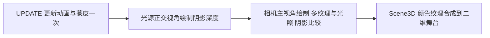

# 基础 3D 光照与阴影实施评估

归档说明：本文于 2026-10-17 归档，保留开发当时的方案、分析与验证状态。当前使用方式和能力边界请从[归档索引](README.md)进入对应使用文档；历史通过记录不代表后续改动已经验证。

日期：2026-10-16。此文保留实现前的方案评估，后续实现进展见下段说明。

后续进展：基础光照与单方向光硬阴影已加入代码，按用户要求尚未编译运行。实际接口、首版限制与交付验证顺序见 [光照与阴影使用说明](../../基础3D光照与阴影使用说明.md)；下文保留实现前评估。

## 结论

当前架构可加入真实动态阴影，建议按“法线与基础光照 → 单方向光硬阴影 → 软化与缓存”的顺序实施。需要同时修改 hxmaker 核心与 hxmaker-openfl 三维后端，GLB 文件仍经现有 Assets 加载，不需要更换模型加载系统。

模型表面的明暗来自光照计算，模型落到地面或自身上的阴影来自遮挡计算。两者可独立实现；阴影贴图本身并不要求法线，但方向光光照、法线偏移和坡度偏差控制会用到法线。推荐先接通光照，使后续阴影自然作用于直接光，而不是简单把整个基础颜色压黑。

## 当前源码提供的能力与缺口

| 项目 | 当前实现 | 所需补充 |
| --- | --- | --- |
| 几何 | Geometry3D 保存位置、UV、索引 | 增加可选法线，校验长度并提供缺失法线生成 |
| GLB | GlbParser 已解码 NORMAL | Model3D 创建 Geometry3D 时传入法线 |
| 蒙皮 | 刚性网格更新矩阵，多权重网格更新位置 | 刚性路径正确变换法线，多权重路径同步更新法线 |
| 材质 | 无光照采样与自定义片元代码 | 增加独立 Lambert 材质和明确的着色模式 |
| 相机 | 透视投影 | 增加供方向光使用的正交投影及光源视图矩阵 |
| 深度 | 每个 Scene3D 的 DEPTH_COMPONENT16 renderbuffer | 另建从光源视角渲染、可供 Shader 采样的阴影目标 |
| 渲染 | 相机主场景 → 二维合成 | 在主场景之前增加阴影 pass |
| 合批 | 四种属性，10 个浮点数/顶点 | 光照路径加入世界法线，并预留阴影 sampler |

现有相机深度缓冲既不是可采样纹理，也不是光源视角；即使改成深度纹理，仍不能省略光源视角的绘制。

## 方案选择

| 方案 | 可获得的效果 | 主要限制 | 建议 |
| --- | --- | --- | --- |
| 脚下半透明贴片 | 低成本增强落地感 | 不反映真实轮廓、遮挡或自阴影 | 可作为低性能设备的独立选项 |
| 平面投影 | 在指定平面上呈现模型投影轮廓 | 只适合约定平面，重叠和遮挡处理受限 | 有固定风格需求时考虑 |
| 单方向光 Shadow Map | 动态地面投影和模型自阴影 | 多一轮光源视角绘制，需要处理分辨率与深度误差 | 推荐作为基础引擎能力 |

首版以当前恐龙和地面为目标：一盏方向光、环境光、Lambert 漫反射、OPAQUE 投影物、地面接收阴影。暂不加入多阴影灯、点光源立方体阴影、级联阴影、透明彩色阴影或 PBR。

## 第一阶段：法线与基础光照

1. Geometry3D 的构造增加可选 normals 参数，保持已有三参数调用兼容。GLB 优先使用文件提供的法线；程序几何补法线，缺失时可按索引生成并归一化，生成规则明确为共享顶点的平滑法线。
2. MeshObject 增加世界法线缓存。刚性网格按最终世界矩阵的逆转置变换，不能直接当位置变换；非均匀缩放、负缩放和双面可见性需要覆盖。通用蒙皮同时更新局部法线，不能让动作改变位置却仍使用静态法线。
3. 新增 DirectionalLight3D、环境光参数与 LambertTextureMaterial。灯光变更通知 Scene3D 失效。GLB 实例化增加可选材质模式或工厂，并约定新材质归实例所有，不由示例直接替换后遗留资源归属问题。
4. MeshBatch3D 光照路径加入法线，最直接的布局为 13 个浮点数/顶点，即 52 字节；现有无光照路径可继续使用原布局。照明模式加入程序和批次键。
5. 光照在统一的线性颜色空间计算，输出时处理显示编码与现有预乘 Alpha。当前 GLB 基础因子已转换为显示色值，无光照路径可保留；新增光照路径必须避免对 sRGB 值直接照明或重复编码。

方向光与环境光足以让浅灰恐龙出现明暗层次，但不会使源文件变成绿色材质，也不会自动产生落地阴影。

## 第二阶段：单方向光阴影

- MeshObject 增加 castShadow / receiveShadow 开关；Scene3D 或灯光显式开启阴影。示例中的地面开启接收、关闭投射，恐龙开启投射和接收。原无光照材质保持其既有语义。
- 新增 ShadowMap3D 目标与深度程序，拥有独立 FBO、阴影纹理与生命周期。首版只让 OPAQUE 投射，明确排除 MASK / BLEND；后续 MASK 必须复用 Alpha 裁剪，不能当作完全不透明处理。
- 根据投射物与接收区域建立光源正交视锥，留出动画边界，并稳定投影范围；不能只包围角色而漏掉地面投影，也不能把无限大的地面纳入后使阴影精度过低。
- 投射物从光源视锥筛选，不能直接复用主相机剔除后的列表：画面外的物体仍可能向画面内投影。
- 主片元程序将位置映射到光源空间，比较当前深度与阴影图深度。视锥外或超出阴影有效范围的采样按不受该阴影遮挡处理。
- 阴影只衰减方向光的直接光贡献，保留环境光，避免阴影区全黑。receiveShadow 作为批次状态或受控着色参数处理，防止合批时串用。
- 优先用深度比较偏差处理自阴影条纹，调节需兼顾阴影脱离物体的问题；双面恐龙不宜统一强制正面剔除来掩盖误差。若使用 polygonOffset，需补充相关状态恢复。

## 深度纹理与降级

WebGL 1 需要检测 WEBGL_depth_texture；WebGL 2 原生提供对应能力。应按上下文探测并缓存能力，并检查 FBO 完整性。规范依据：[Khronos 深度纹理扩展](https://registry.khronos.org/webgl/extensions/WEBGL_depth_texture/)、[MDN WebGL 1 / 2 能力说明](https://developer.mozilla.org/en-US/docs/Web/API/WEBGL_depth_texture)。

首版建议优先深度纹理；设备不支持或目标创建失败时，关闭阴影并给出可见状态，继续保留基础光照。RGBA 编码深度可以后续作为独立兼容路径，需要额外处理精度、编码、清除值和关闭颜色抖动，不应在第一版未经验证就承诺兼容所有 WebGL 1 设备。

初始可选 512 / 1024 分辨率，固定为阴影贴图像素尺寸，不自动乘显示设备像素比。1024² 的 16 位深度存储下限估算约 2 MiB；若为兼容额外附加 RGBA8 颜色目标，则附件合计估算约 6 MiB，实际受驱动分配与格式影响。多个 Scene3D 各自持有阴影目标，不共享不同场景的深度。

## 多纹理合批与后端修改

多纹理保留。阴影图是每个场景/灯光的公共 sampler，不按模型创建，不为每张基础贴图生成一次阴影 pass。开启阴影时从可用片元纹理单元中预留一个，剩余单元继续用于基础贴图合批。例如原本上限 16 时，带阴影程序最多使用 15 个基础贴图单元；具体还受设备与程序链接能力限制。

需要修改的后端主要为：

- Renderer3D：收集与复用世界几何、阴影 pass、灯光/阴影缓存失效、主场景提交、统计与资源释放。
- MultiTextureShader3D / Program3DInfo：光照与阴影程序变体，新增内置参数和 sampler 的缓存登记；不能把阴影 sampler 当作仅支持浮点数的自定义 uniform，也不能将新增内置参数逐批误清零。
- MeshBatch3D：法线布局、光照与 receiveShadow 的合批兼容条件。
- RenderStateGuard3D：当前只保护属性 0～3；新增法线属性后需扩大保护范围并检查设备属性上限，同时覆盖新纹理单元。若引入 polygonOffset 或深度颜色编码，还要恢复偏移因子/单位或 DITHER 状态。
- 新 ShadowMap3D / ShadowShader3D：目标分配、完整性检查、正交深度绘制与上下文失效处理。

状态保护仍包住整个三维回调，内部在阴影目标、主目标与原二维目标之间切换。尽量不为每个 pass 重做完整 GL 查询快照，避免抵消此前移除同步查询的优化。

## 第三阶段与性能边界

先确认硬阴影正确，再增加 2×2 或 3×3 PCF，通过多次深度比较软化边缘；3×3 通常需要每个接收片元进行 9 次阴影深度采样，不能仅以模型三角形少就判断便宜。

阴影多一轮投射物绘制，增加顶点上传、片元填充和采样开销，不意味着整个页面耗时必然翻倍。当前恐龙约 1,330 个三角形，值得先做单光源版本，但目标分辨率、屏幕覆盖与固定状态开销仍需实测。

动画与蒙皮只更新一次，两轮绘制复用同一姿态与世界顶点结果。首版可在动态场景每帧更新阴影；后续按投射物、灯光与投影范围的独立版本缓存静态阴影，避免仅移动观察相机就重绘与其无关的固定阴影。不能只依赖当前每帧改变的 Scene3D.contentVersion 来实现有效阴影缓存。

## 验收建议

先用立方体与平面确认方向、深度比较、偏差和状态恢复，再接入恐龙动画。覆盖动作阴影同步、非均匀/负缩放、双面材质、自阴影、主相机外投射物、多 Scene3D、尺寸变更、多纹理槽位边界、阴影开关与不支持设备降级。

新增 shadowDrawCalls、shadowTriangles、shadowMapBytes 等独立统计，区分主场景与阴影成本。对比无光照、仅光照、硬阴影和 PCF 的耗时；同时回归二维文字、遮罩和共享纹理，继续记录现有工具链的上下文恢复限制。实现完成后按仓库要求先通知，再执行获授权的测试。
