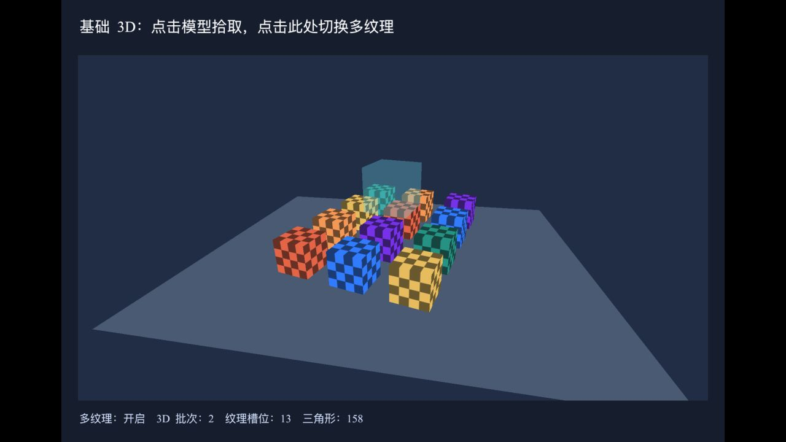

# 基础 3D 渲染优化记录

日期：2026-10-16。基于 [优化前 Trace 分析](基础3D渲染性能分析-20261016.md) 实施。

## 结果与范围

基础示例同环境短测中，完整三维渲染回调的平均墙钟耗时由 **7.34 ms 降至 3.38 ms，降低约 53.9%**。多纹理模式仍为 2 个三维批次、13 个纹理槽位、158 个三角形，最终合成另计 1 次绘制。单纹理模式仍为 14 个三维批次。

主要改动在 hxmaker-openfl 的 `src/hx/render3d/openfl/`；hxmaker 核心接口没有改变，本仓库增加可选诊断场景和文档。

## 实现

1. **共享纹理采样状态**：TextureBridge3D 返回 OpenFL TextureBase，临时采样与恢复通过 OpenFL 的采样协议执行。每次回调读取当前缓存快照，而非永久记住纹理第一次使用的状态。默认移除每纹理四次 getTexParameter；本示例涉及 13 张纹理，减少约 52 次同步查询。尚无采样缓存的纹理恢复 GL 初始值。
2. **设备能力**：纹理槽位、属性数、目标尺寸和视口上限按上下文查询一次。删除稳态每回调的六项设备能力查询。
3. **程序信息**：新增 Program3DInfo，链接时反射活动 uniform 并缓存位置和类型；绘制时直接使用。缺省参数仍逐批重置为零，参数长度仍校验，避免材质共享程序后串用。
4. **资源失效**：删除逐帧 isBuffer 探测，通过上下文对象变化、Stage3D 创建事件和 HTML5 canvas 丢失/恢复事件使缓存失效。dispose 时移除 canvas 监听。
5. **保留状态边界**：程序、目标、视口、纹理绑定、顶点属性、深度、混合、裁剪等动态状态仍完整保存恢复。此次没有用固定默认值替换这些动态状态。

默认路径要求共享纹理的采样参数通过 OpenFL 设置。外部代码直接用原始 GL 修改共享纹理时，可加 `-D hxmaker_3d_full_state_queries`，重新读取并恢复真实采样参数，包括支持时的各向异性参数。这一兼容路径会增加查询开销。

## 计时方法

- 同一台机器、Codex 内置浏览器、同一示例与默认视口；逻辑尺寸 960×640，截图视口 1280×720。
- 优化前后均使用 `-D hxmaker_3d_profile`，未启用回归探针。
- 使用 performance.now；每个版本跳过前 120 次回调，再取最初三组、每组 240 次，共 720 次。
- 范围从 Renderer3D.render 的有效 GL 检查之后，到状态恢复完成，包括三维重绘、最终合成与状态保护。初始化基本由预热排除。
- 这是墙钟提交时间，包含同步查询等待；**不是 GPU 执行时间，也不是整个 requestAnimationFrame 的时间**。
- 原 Chrome Trace 中的 5.06 ms 是另一浏览器中的完整动画回调，不能与这里的数值直接比较。

| 版本 / 组 | 平均 ms | P50 ms | P95 ms | 最大 ms |
| --- | ---: | ---: | ---: | ---: |
| 优化前 1 | 6.717 | 6.400 | 10.000 | 13.300 |
| 优化前 2 | 7.580 | 7.100 | 11.000 | 17.000 |
| 优化前 3 | 7.713 | 7.300 | 11.000 | 22.700 |
| 优化后 1 | 3.338 | 3.100 | 6.400 | 9.900 |
| 优化后 2 | 3.349 | 3.000 | 6.200 | 9.400 |
| 优化后 3 | 3.457 | 3.000 | 6.500 | 13.100 |

等量样本合并均值：7.3364 → 3.3813 ms，减少 3.9551 ms。表中分位数为各组分位数，没有将其平均后冒充合并分位数。原始分组数值和时间戳保存在 [计时数据](data/3d-profile-20261016.json)。

后台负载和浏览器调度会影响短测；后续组曾出现 46.2 ms 的单次离群值。因此不能由这组均值推断没有长帧，也不能推断 GPU 利用率、最大模型容量或移动设备收益。

## 验证

本轮沿用用户已授权的 HTML5 示例验证。已有 Lime 服务器运行于 localhost:3000，因此用 `arch -x86_64 lime build html5` 重建后刷新同一浏览器。

| 检查 | 结果 |
| --- | --- |
| 普通 HTML5 构建 | 通过；最终恢复为无诊断参数的构建 |
| 多纹理 / 单纹理切换 | 通过；批次 2 / 14，三角形均为 158 |
| 普通画面、动画、透明与二维文字 | 浏览器可见，最终控制台无新增错误 |
| 同一纹理在三维前后用于二维绘制 | 默认路径连续 120 帧通过；每 30 帧交换 NEAREST / LINEAR，独立查询真实 GL 参数断言 |
| 完整查询兼容路径 | 编译通过，连续 120 帧共享采样状态检查通过 |
| 自定义 uniform 隔离 | 三份材质共用程序，红、绿、缺省黑色均正确显示 |
| 主动上下文丢失 / 恢复 | 三维资源可重建，但整页恢复未通过；见下文 |

诊断实现见 [Regression3D.hx](../samples/basic-3d/Source/Regression3D.hx)，运行方式见 [示例说明](../samples/basic-3d/README.md)。诊断探针只在显式启用参数时编译，不参与性能采样。

## 已知限制与后续方向

使用 WEBGL_lose_context 主动丢失上下文后，三维场景可恢复绘制，但二维贴图与文字消失，采样探针读到 GL 初始参数。将所有 Scene3D 设为不可见的纯二维对照也复现了同样失败，因此不能归因于此次三维采样缓存优化；具体二维资源重建根因仍需独立定位。当前不得宣称整页上下文恢复已经兼容。

动态 GL 状态快照仍有固定成本。后续优化应测量剩余 getParameter、顶点属性查询和纹理绑定快照，建立与 OpenFL 一致的状态所有权协议后再减少它们。复杂父级遮罩、原始 GL 插件混用及其他平台尚未覆盖。

## 最终普通示例

