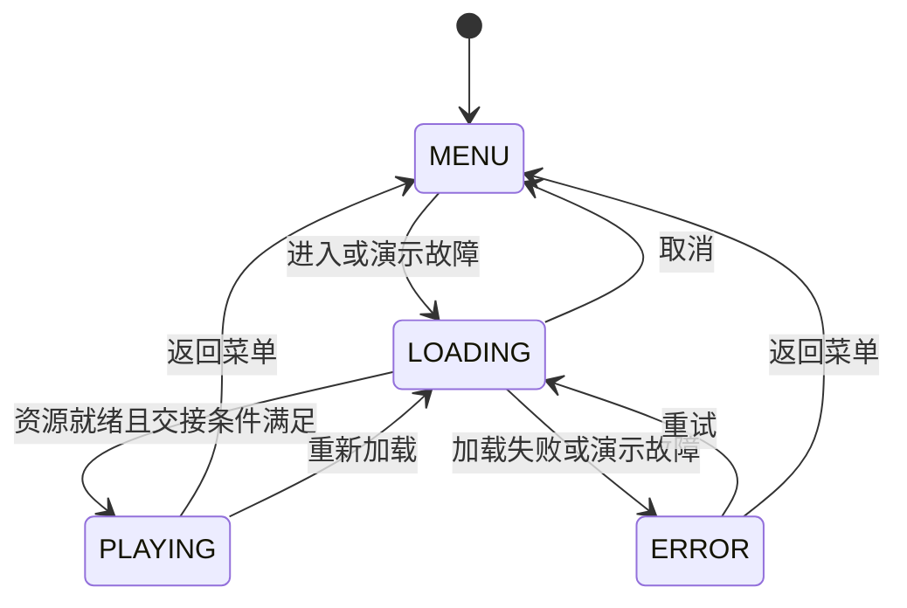

# 完整 3D 角色项目示例说明

日期：2026-10-16，更新于 2026-10-17。用户已反馈完整角色流程示例测试通过，本轮补充 HTML5 构建验证。相关核心的贴图、动画、挂点与相机自动回归见[验收记录](3D导航验收记录.md)。

## 本阶段交付

新增 [samples/interactive-character](../samples/interactive-character/README.md)，以纯 hxmaker API 演示一个完整的小型角色场景：菜单配置、资源加载与取消、角色操作、场景退出、重新加载、错误重试，以及流程整体重建。

初版使用现有接口完成整合。后续输入修复在核心 Scene3DInput 中固定按下时的拾取快照，保留左键点击／拖动；不增加渲染后端接口，不改动多纹理合批、GL 状态保护、上下文恢复或帧调度。角色移动、流程、配置与诊断均为示例业务代码，未提升为强制引擎组件。相关输入及拾取断言已在本轮浏览器回归中通过。

## 流程与更新所有权



Main 继承 HxmakerApplication，Game 继承 Stage，各业务界面继承 Scene。GameContext 显式创建独立的 ProcedureManager，并注册四个带上下文的 IProcedure 实现。

当前 OpenFL Engine 已在帧更新中调用全局 ProcedureManager.instance.update。因此示例选择独立实例，由 Game.onUpdate 每帧驱动一次；既不重复驱动全局实例，也不创建第二个帧循环。

顺序为：

1. GameContext 提交上次排队的流程切换，每帧最多提交一次。
2. 当前 Procedure 执行业务 update。
3. PlayProcedure 调用 CharacterScene.step：位移与动作选择 → 每角色一次 Model3D.update → 相机更新。
4. Game 调用 super.onUpdate，更新显示树与 Scene3D 设置，不再次执行角色模拟。

异步加载完成与 UI 操作只排队请求状态，避免在 Procedure.onEnter/onLeave 的栈内重入切换。业务更新错误进入错误流程；场景创建失败先释放已创建对象，再交给错误界面。

## Assets 会话与取消

CharacterAssetSession 是单次加载包装，内部只用 Assets.loadGlb。每次进入加载流程创建新会话，禁止复用已释放会话。

资源就绪后，LoadingProcedure 保留该会话交给 PlayProcedure，角色借用其 GLB 源资源和贴图。取消与错误路径释放会话；游戏退出时，先销毁输入与模型、三维视口、自建几何和材质，再释放会话。

Assets.stop 不保证终止已经发出的请求。因此取消必须同时做两件事：立即标记会话失效并清空业务回调；在迟到的成功或错误终态里再次 clean，释放之后才取得的资源引用。GameContext.requestMenu 在加载阶段会立即使会话失效，避免加载完成在下一次流程更新之前覆盖用户的取消意图。

诊断分别记录“逻辑会话已释放”和“在途请求已结束”。取消后会话数可以为零而在途数仍大于零，终态送达后再减少在途计数，不把 stop 当作物理请求已取消的证据。

## 角色与显示层

CharacterActor 管理单个模型的移动目标、Idle/Walk 选择、播放速度及道具挂点。它不注册帧回调，不管理 Assets，也不接触渲染器。

CharacterScene 持有多个 CharacterActor、一份共享道具几何／材质、地面与标记、一个 Scene3D、相机控制器和 Scene3DInput。角色实例独立，共享源贴图；道具沿普通骨骼节点树绘制，继续参与兼容状态下的多纹理合批。

停止移动使用待机过渡；暂停跳过位移和动画推进，相机保持可操作。整体位移只修改 Model3D 外层变换，挂点偏移不被动画覆盖。场景内二维 UI 利用已有事件路由阻挡场景操作。

鼠标与触摸都使用 SELECT 区分轻点与拖动：按下时固定拾取快照，抬起确认轻点后设置目标，角色由后续唯一的业务更新推进。超过阈值开始左键／单指旋转时清除快照，不误下达移动指令。相机仍在平滑转动时也可确认轻点，无需等待镜头停稳。

配置暂用 SampleConfig 的代码字段并做基本验证，不冻结 JSON 场景或预制体格式。示例运动学不包含碰撞、寻路、根运动或物理。

## 释放与诊断边界

释放顺序：

1. 输入适配 dispose，解除舞台捕获及视口监听。
2. 销毁所有角色和附件；释放控制器引用。
3. 销毁 Scene，Scene3D 释放节点树并通知后端释放目标等资源。
4. 检查自建 Geometry3D／Material3D 引用归零并 dispose。
5. 最后清理 Assets 会话。

GameContext.dispose 先销毁独立 ProcedureManager，让当前流程正常 onLeave，再执行幂等兜底清理。重建流程不会替换全局管理器，也不影响引擎帧率。

SampleAudit 只保留数值、布尔值与文本，不持有场景或资源对象。历史事件最多 80 条、释放记录最多 30 条、真实错误最多 30 条、CPU 样本最多 300 条；流程重建后继续累计，以保留旧在途结果的处理记录。

每轮循环必须实际观测到 Scene3D.renderId 大于零，且完成退出后才增加循环计数。它证明示例执行了加载、绘制和释放路径，不自动判断画面正确。

报告通过 Haxe trace 输出 JSON，不使用原生文件、浏览器下载或剪贴板 API。资源计数不代表底层缓存为空或驱动显存立即释放；CPU 样本不是 GPU 时间。状态保护阶段可能与主通道计时重叠，不将各字段相加计算总耗时。

由于角色数、镜头与渲染开关可变，报告中的 CPU 均值/P95 只是最近观测窗口，不能直接与旧固定场景报告比较并宣称优化收益。固定负载回归继续使用 engine-acceptance。

## 验收入口

用户执行：

```bash
cd /Users/rainy/Documents/haxelib-self/rainyt/hxmaker/samples/interactive-character
arch -x86_64 lime test html5
```

先正常进入，再检查取消、演示故障与重试、游戏重载、整个流程重建，最后手动启动五轮循环并在菜单输出报告。预期每次正常释放记录中，模型、输入与视口已销毁，自建几何／材质引用为零且已 dispose；无在途加载时菜单的活动会话和三维世界均为零。

本轮只做源码静态审阅与差异格式检查，没有编译、启动浏览器、运行循环或其他测试，也没有生成实测报告。完整的第二阶段验收仍需用户确认本示例，并根据需要进行原有混合渲染、恢复与固定性能基线回归。
